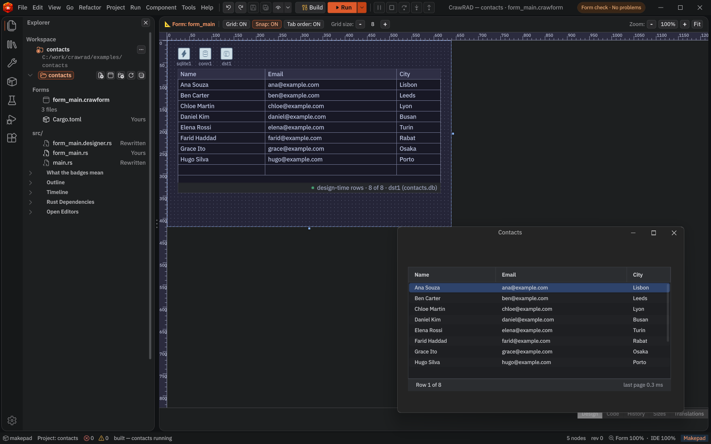

<div align="center">


# CrawRAD

**A RAD IDE for Rust.** Drop components on a form, set them in the Object Inspector,
double-click to write the event, build a native app.


[](https://isaquepinheiro.com.br/crawrad/manual/)
[](https://link.mercadopago.com.br/isaquepinheiro)



</div>

---

CrawRAD brings the classic RAD workflow to Rust: a visual form designer, an Object
Inspector, a component palette and an event model — and what you design compiles to an
ordinary Rust project you own, with no runtime lock-in.

> **Where this comes from.** CrawRAD was built in a private repository for 14 months —
> over 700 merged changes and 300 issues — before this public release. This repository
> starts from that work as a single commit.

## What it does today

The full list, with what comes next, is in **[ROADMAP.md](ROADMAP.md)**. In short:

- **Form Designer** with alignment, anchors, containers, z-order and a live Preview.
- **Object Inspector** with property editors by type, events and data binding.
- **Component palette** (51 components), including data-aware grids and non-visual
  components; your own components can be installed into the palette.
- **Code editor** with a Rust language server (completion, diagnostics, go to
  definition, inlay hints) and a debugger.
- **Build and Run** for desktop (Windows, Linux, macOS) and the web.

## Building the IDE

You need a recent stable Rust toolchain (edition 2024).

```bash
cargo ide           # = cargo build -p crawrad-ide -p crawrad-dbprobe
cargo ide-release   # the same, --release
cargo test --workspace
```

`crawrad-dbprobe` must sit next to `crawrad-ide.exe`: the Object Inspector runs it to
list a dataset's columns in Data › Field. Built without it, the Field row stays free
text and says so.

## Documentation

**Read the manual: [isaquepinheiro.com.br/crawrad/manual](https://isaquepinheiro.com.br/crawrad/manual/)**
— tutorials, how-to guides, concepts and reference. Its source lives in [`docs/`](docs/)
(mdBook, organised by the [Diátaxis](https://diataxis.fr/) framework). Small real projects you can open in the IDE
are in [`examples/`](examples/).

## Support CrawRAD

<div align="center">

**CrawRAD is free software — built and maintained by one developer.**

### **[→ Donate / Sponsor CrawRAD ←](https://link.mercadopago.com.br/isaquepinheiro)**

*Any amount, any payment method — you choose both. Card, Pix or boleto.*

**In Brazil? Pix goes further** — it reaches the project with no processor fee.


**Pix key (random):** `4b155305-2671-4c39-8d58-7b9b5c428e18`

</div>

There is no paywall and no paid tier: every feature is in the build you download.
What keeps CrawRAD moving are donations and the AI subscriptions its own development
runs on, which one person pays for. **Companies:** if CrawRAD is part of your toolchain,
sponsoring it is the cheapest way to keep it alive — ask and an invoice will be sorted.
Code is just as welcome as money; see [Contributing](#contributing).

## Contributing

Issues and pull requests are welcome — see [CONTRIBUTING.md](CONTRIBUTING.md).
Contributions are accepted under the [CLA](CLA.md).

## License

- **The IDE** is free software under the **[GPL v3](LICENSE)**, with the output exception
  in [`ADDITIONAL-PERMISSIONS.md`](ADDITIONAL-PERMISSIONS.md): the code CrawRAD generates
  for your project is **yours**, under any license you choose — closed and commercial
  included.
- **The runtime that ships inside your app** (`crawrad-runtime*`, the binding, the
  component SDK and the `components/` suite, such as PortaDB) is **MIT OR Apache-2.0**
  ([`LICENSE-MIT`](LICENSE-MIT), [`LICENSE-APACHE`](LICENSE-APACHE)). Using it never
  brings the GPL into your app.
- Dependencies pass an allowlist in [`deny.toml`](deny.toml): GPL, AGPL, LGPL and SSPL
  stay out, so the runtime remains free of copyleft.
- **Security:** responsible disclosure policy in [`SECURITY.md`](SECURITY.md). Each
  release attaches a CycloneDX SBOM per distributed binary and SHA-256 checksums.
- **Trademarks:** CrawRAD is an independent project. It is not an official Rust project
  and is not affiliated with the Rust Foundation — see [`TRADEMARKS.md`](TRADEMARKS.md).
