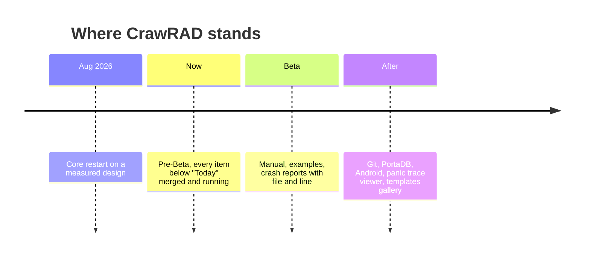

# CrawRAD Roadmap

**A RAD IDE for Rust.** Drop components on a form, set them in the Object Inspector,
double-click to write the event, build a native app.

[Today](#-today) · [Before the Beta](#-before-the-beta) · [After the Beta](#-after-the-beta)

---

| Legend | |
|:--:|---|
| ✅ | Merged and working in the IDE |
| 🚧 | In progress for the Beta |
| 🗓️ | Planned after the Beta, with an open issue |

---

## ✅ Today

<table>
<tr><td width="50%" valign="top">

### 🎨 Visual designer
- Form Designer with snap, grid, zoom and Tab order badges
- Object Inspector with typed editors per property type
- Collection editors: Grid columns, StatusBar panels, TreeView items
- **Visual form inheritance**, inherited events, New Inherited Form
- **Form checker**: problems pinned on the canvas, one-click fixes
- **Sizes tab**: the form at several sizes, overflows in red
- **Translations**: preview the form, or run the app, in any language

</td><td width="50%" valign="top">

### 🧩 Components
- **51 components** on five palette pages, with the classic events of
  their kind ([reference](docs/src/reference/components.md))
- **Data Grid bound to a table**: real rows at design time, typed columns,
  sort, group, totals, filter row, in-cell editing with write-back
- Dataset with Browse, Edit and Insert on our own data engine
- **Your own components**: inherit a native one, or install a package
  with no restart

</td></tr>
<tr><td valign="top">

### ⌨️ Code editor
- rust-analyzer: completion in three columns, hover cards, code lenses,
  diagnostics, code actions
- Code templates (`Ctrl+J`), change bars, bookmarks, breadcrumb
- **Local file history** with diff and restore
- **Notes**: docs, notes and comments outside the source, rendered
  into rustdoc, with the `crawrad note` CLI

</td><td valign="top">

### 🔨 Build, run and test
- Build window with live progress and a real Cancel
- Run on desktop; **a Web App runs as WebAssembly in the browser**
- Your app's panic lands in the Problems panel and the editor
- **Tests panel**: `cargo test` as a tree, a click goes to the assert
- Release report: size per build, Size page, Shrink dialog
- Seven project templates ([reference](docs/src/reference/templates.md))

</td></tr>
<tr><td valign="top">

### 🤖 AI and automation
- **MCP server**: an agent or a script drives the whole IDE: design,
  code, build, run, screen capture
- **Aefos AI** chat sees the form and the selection; explain, review, fix
- Rust teacher mode: `/teach`, `/why`, `/fix-explain`

</td><td valign="top">

### 🖥️ The IDE itself
- Two keymaps, VS Code and Classic, plus a command palette
  ([commands](docs/src/reference/commands.md),
  [shortcuts](docs/src/reference/shortcuts.md))
- Welcome page, auto save, recovery of unsaved work
- Desktop layouts per project; settings in SQLite

</td></tr>
</table>

---

## 🚧 Before the Beta

| | Item | Why it matters |
|:--:|---|---|
| 📘 | **The manual**: tutorials, how-to guides, reference, concepts (mdBook) | Every tutorial step is done in the real IDE and captured |
| 🧪 | **`examples/` folder** of small real projects | Each one is compiled by CI, so none can rot |
| 🔎 | **Component picker** at the top of the Object Inspector | Reach any component of the form from one list |
| ▶️ | **Run progress card** in the centre of the IDE | You see the build; it closes itself when the app opens |
| 🩺 | **Crash reports with file and line** | Any report a user sends points at the exact line |

---

## 🗓️ After the Beta

| Area | Planned | Issue |
|---|---|:--:|
| 🐞 Debugging | Panic trace viewer for your running app: your frames first, a click opens the line | [#2](https://github.com/ModernRustWorks/crawrad/issues/2) |
| 🌿 Source control | Git inside the IDE: changes, gutter diff, branches, history, conflicts | [#11](https://github.com/ModernRustWorks/crawrad/issues/11) |
| 🗄️ Data | **PortaDB**: one database layer, a provider per engine, SQL checked at compile time | [#1](https://github.com/ModernRustWorks/crawrad/issues/1) |
| 🌐 Web | Live reload | [#15](https://github.com/ModernRustWorks/crawrad/issues/15) |
| 🌐 Web | Publish as a static folder | [#16](https://github.com/ModernRustWorks/crawrad/issues/16) |
| 📱 Mobile | Run on an Android device or emulator | [#18](https://github.com/ModernRustWorks/crawrad/issues/18) |
| 🧰 Toolchain | Missing targets (wasm32, Android) installed in one click | [#14](https://github.com/ModernRustWorks/crawrad/issues/14) |
| ▶️ Run | Build progress for web and mobile Run | [#17](https://github.com/ModernRustWorks/crawrad/issues/17) |
| 🗂️ Templates | Installable templates with wizards and a public gallery | [#12](https://github.com/ModernRustWorks/crawrad/issues/12) |
| 🎮 Templates | Game projects: design the flow visually | [#7](https://github.com/ModernRustWorks/crawrad/issues/7) |
| ⚡ Templates | GPU projects with CUDA | [#5](https://github.com/ModernRustWorks/crawrad/issues/5) |
| ⛓️ Templates | Educational blockchain | [#4](https://github.com/ModernRustWorks/crawrad/issues/4) |
| 🎨 Editor | Colour schemes | [#10](https://github.com/ModernRustWorks/crawrad/issues/10) |
| 🌍 Editor | Any language through installable language packages | [#9](https://github.com/ModernRustWorks/crawrad/issues/9) |
| 🐍 Editor | Python with Rust through PyO3 | [#8](https://github.com/ModernRustWorks/crawrad/issues/8) |
| ✔️ Quality | Lint manager for rustc, Clippy and custom rules | [#13](https://github.com/ModernRustWorks/crawrad/issues/13) |
| 💻 Terminal | Built-in terminal panel | [#3](https://github.com/ModernRustWorks/crawrad/issues/3) |
| 📝 Notes | The note crate published for any Rust project | [#6](https://github.com/ModernRustWorks/crawrad/issues/6) |

---

This page lists only what is merged (✅) or has an open issue (🚧 🗓️). Nothing here is a promise without a plan behind it.

