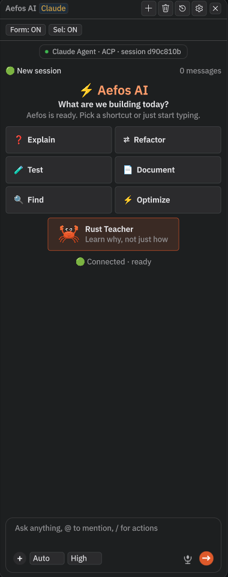
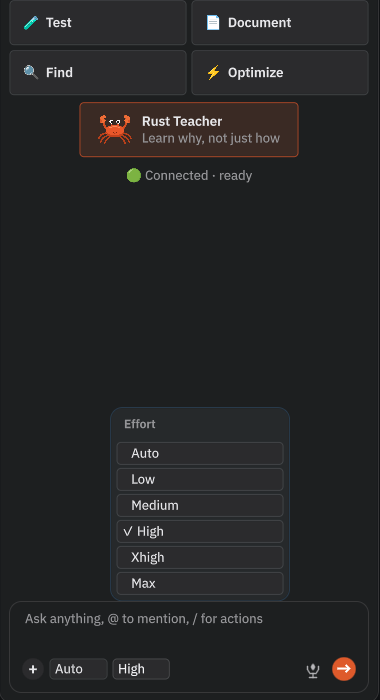
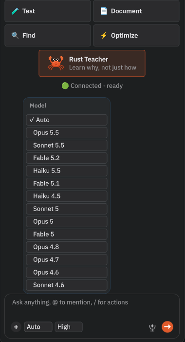
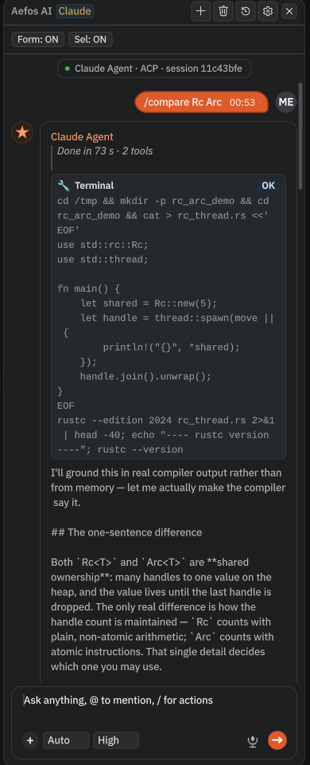
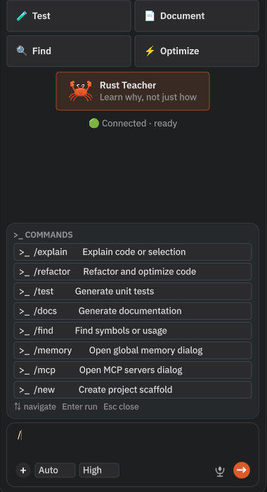
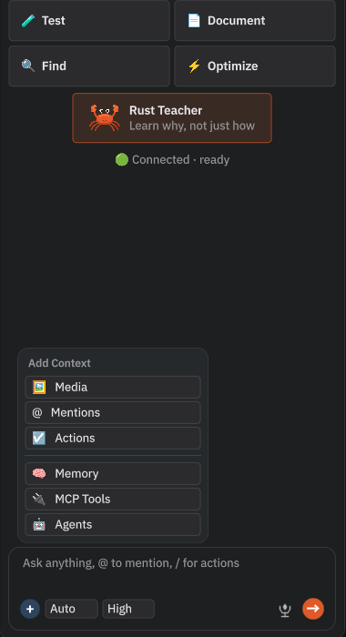
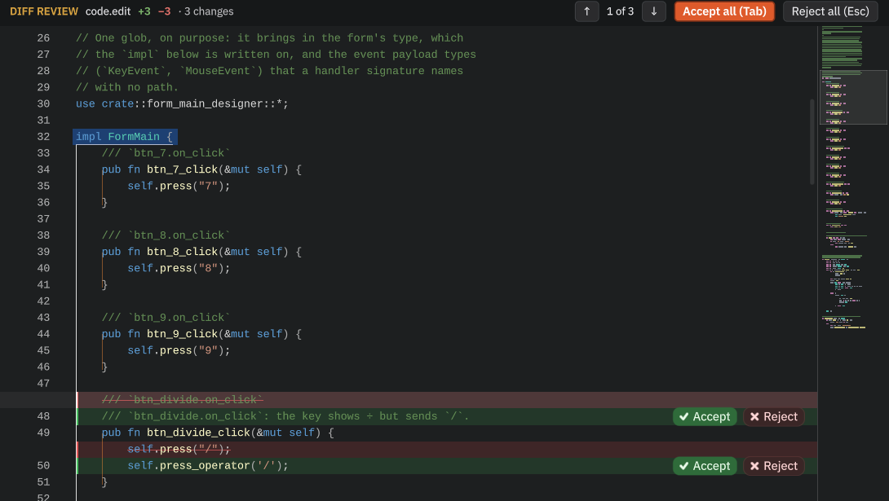
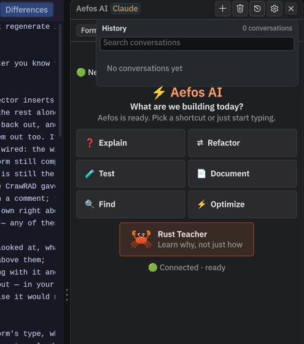

# Use the AI assistant

CrawRAD includes a built-in AI assistant interface, branded as **Aefos AI**, connected to external agents through the Agent Client Protocol (ACP) and Model Context Protocol (MCP).

## Open and close the Chat panel

The Chat panel provides the interactive conversation surface for requesting code edits, explanations, and project guidance.

1. To open the panel from the menu, select **View > Panels > Chat**.
2. To open the panel from the command palette, press <kbd>Ctrl</kbd>+<kbd>Shift</kbd>+<kbd>P</kbd>, type `Toggle panel`, press <kbd>Enter</kbd>, and choose `chat`.
   The Chat has no shortcut of its own.
3. To close the panel, click the **✕** close button in the panel header, or select **View > Panels > Chat** again.

You see the **Aefos AI** dockable tab appear in the right dock with its header, status line, message list or hero shortcuts, context toggles, and prompt input bar.



## Use the Chat header buttons

The header buttons let you start a clean conversation, wipe messages, view past history, open ACP settings, or close the panel.

1. Click **New session** (the page/plus icon) to start a new chat session, resetting the live agent connection and restoring the initial hero shortcuts.
2. Click **Clear** (the trash/eraser icon) or type `/clear` to wipe all messages from the active session.
3. Click **History** (the clock icon) to toggle the conversation history popup list.
4. Click **Settings** (the gear icon) or type `/settings` to open **Tools > Options** directly at **AI Assistant / Agent Client Protocol (ACP)**.
5. Click **Close** (the **✕** button) to close the Chat panel.

You see the header title `Aefos AI`, the active agent badge (such as `Claude`, `Gemini`, `Active`, or `No agent`), the session status indicator (such as `🟢 New session` and `0 messages`), and the row of action buttons.


## Pick the agent, model, mode, and effort selectors

The selectors at the bottom of the prompt bar control which agent responds, which model generates the output, whether reasoning effort is applied, and whether tool execution mode is active.

1. To switch the active agent, type `/use <agent-name>` in the prompt (for example, `/use claude` or `/use gemini`), or open **Tools > Options** and choose the agent in **AI Assistant / Agent Client Protocol (ACP)**.
2. To change the model, click the model button at the bottom of the prompt bar (it shows **Auto** at first) and pick one from the **Model** list. The list is the one the agent offers.
3. To change how hard the agent thinks, click the effort button next to it and pick **Auto**, **Low**, **Medium**, **High**, **Xhigh** or **Max**. It shows only when the agent supports it.
4. To run a prompt in autonomous agent mode allowing tool usage, prefix the prompt with `/agent` (e.g. `/agent create a login form`).

You see the buttons show the model and the effort you picked.





## Empty panel shortcut cards and the Rust Teacher card

When starting a session with no active messages, the panel displays hero action shortcut cards for common development tasks.

1. Click **❓  Explain** to populate `/explain ` into the prompt for understanding selected code or components.
2. Click **⇄  Refactor** to populate `/refactor ` into the prompt for restructuring code.
3. Click **🧪  Test** to populate `/test ` into the prompt for generating unit tests.
4. Click **📄  Document** to populate `/docs ` into the prompt for drafting documentation comments.
5. Click **🔍  Find** to populate `/find ` into the prompt for semantic search across files and components.
6. Click **⚡  Optimize** to populate `/refactor optimize ` into the prompt for performance optimizations.
7. Click the **Rust Teacher** card (featuring the crab icon and the caption `Learn why, not just how`) to populate `/teach ` into the prompt.

You see the hero block with the `⚡ Aefos AI` badge, the heading `What are we building today?`, the subtitle `Aefos is ready. Pick a shortcut or just start typing.`, the grid of six shortcut cards, and the dedicated Rust Teacher card.


## Learn with the Rust Teacher

The Rust Teacher teaches language rules, lifetimes, borrows, and type mechanics grounded in compiler diagnostics and official reference material.

1. To explain code line by line, select a code snippet in the editor and send `/teach` (or `/teach <topic>`).
2. To understand why a compiler error occurred, place the caret on a line showing an error diagnostic and send `/why`.
3. To obtain a minimal correction with an explanation, place the caret on an error line and send `/fix-explain` (or press <kbd>Ctrl</kbd>+<kbd>.</kbd> (<kbd>Ctrl</kbd>+<kbd>.</kbd>) and select **Fix and Explain**).
4. To compare two language concepts or types, send `/compare <a> <b>` (for example, `/compare Rc Arc`, `/compare &str String`, or `/compare ? unwrap`).

You see explanations citing ownership transfers, reference scopes, borrow rules, compiler diagnostic codes, and direct quotations from compiler explanations and official documentation, with fixes displayed as code blocks or reviewable diffs.



## Write a prompt, mention files, and run slash commands

The prompt bar allows typing natural language instructions, referencing project files with `@`, and executing built-in slash commands with `/`.

1. Click the prompt input field (`Ask anything, @ to mention, / for actions`) and type your question or instruction.
2. Type `@` followed by the file's path from the project folder (for example,
   `@src/main.rs`) to mention a project file in your request. No list opens:
   type the whole path. The file is read when you send. To mention the file
   you are editing without typing, choose **Refactor › Add File to Chat**.
3. Type `/` at the beginning of the prompt to display the popup list of commands (`>_ COMMANDS`). Move up or down the list with <kbd>Up</kbd> and <kbd>Down</kbd>, press <kbd>Enter</kbd> to pick a command, or press <kbd>Esc</kbd> to close the list.
4. Submit the prompt by pressing <kbd>Enter</kbd> or clicking the send button (`→`). If the agent is currently working, the message is automatically placed into the **Queued Messages** list.
5. Use any of the built-in slash commands:
   - `/explain`: Explain the selected code or visual component.
   - `/refactor`: Refactor selected code or optimize component structure.
   - `/review`: Review the selected code for problems, risks, and missing tests (read-only).
   - `/test`: Generate `#[test]` unit tests for the active code.
   - `/docs`: Generate documentation comments for active units.
   - `/teach`: Teach the selected code line by line (ownership, borrows, types).
   - `/why`: Explain why the compiler rejects the code on the caret's line.
   - `/fix-explain`: Fix the diagnostic on the caret's line and explain why.
   - `/compare`: Compare two language choices, e.g. `/compare Rc Arc`.
   - `/find`: Semantic search across components, actions, and code (opens Quick Open).
   - `/plan`: Show agent implementation plan card and approval controls (`/plan auto` toggles auto-approve).
   - `/queue`: Queue a prompt to send when the agent is free (`/queue <prompt>`).
   - `/agent`: Send the prompt in autonomous agent mode allowing tool usage.
   - `/actions`: Open the ActionList editor of the active form.
   - `/memory`: Open and edit global assistant instructions and memory.
   - `/mcp`: Manage connected Model Context Protocol (MCP) servers.
   - `/acp`: Show ACP status, test connections (`/acp test`), or query agent (`/acp ask <query>`).
   - `/use`: Switch the chat to another connected ACP agent (e.g. `/use claude`, or `/use` alone to list available agents).
   - `/clear`: Start a new conversation.
   - `/settings`: Open the IDE options at AI Assistant / Agent Client Protocol (ACP).
   - `/new`: Scaffold a new project from templates.
   - `/help`: List every slash command and usage description.

You see your message bubble appear on the right side with your avatar (`ME`), followed by the assistant's live status row, tool execution cards, or markdown response on the left.



## Attach files and selections

Attachments provide the agent with targeted code context without manual copying and pasting.

1. Click the **+** button at the left of the prompt bar. The **Add Context** menu opens.
2. Select one of the context options:
   - **🖼   Media**: Appends `@media:assets/` to reference media files.
   - **@   Mentions**: Appends `@file` for the active editor file.
   - **☑   Actions**: Opens the slash commands popup.
   - **🧠   Memory**: Opens the global instructions memory dialog.
   - **🔌   MCP Tools**: Opens the ACP options dialog.
   - **🤖   Agents**: Opens the ACP options dialog.
3. To attach code directly from the editor, select code, right-click to open the context menu, and choose:
   - **Add File to Chat**: Adds `@file` to the prompt without sending.
   - **Add Selection to Chat**: Attaches the selected snippet as a chip above the prompt.
   - **Explain Selection**: Attaches the snippet and immediately sends an explanation prompt.
   - **Review Selection**: Attaches the snippet and requests a read-only code review.
4. To remove an attached item before sending, click the **✕** button on its chip above the prompt bar. Up to 4 attachments can be included in a single prompt.

You see attachment chips appear above the prompt input bar showing the file path or selection line range and a close button.



## Respond to permission requests

When an agent needs to execute terminal commands or write files to disk, CrawRAD pauses and displays an inline permission card in the chat.

1. Inspect the tool name, target path, and command arguments presented in the card.
2. Click **Allow Once** to approve this single operation.
3. Click **Allow Always** to approve this tool and target for the rest of the session.
4. Click **Deny** to refuse this specific operation.
5. Click **Deny Always** to refuse this tool for the rest of the session.

You see the `🛡️ Permission Request` card displaying the tool name in orange, the target path, command parameters, a 60-second countdown timer, and the decision buttons.

<!-- SHOT: Inline permission request card in the chat panel with Tool, Target, and the four allow/deny buttons -->

## Review code proposed by the agent

When an agent proposes edits to a project file, CrawRAD displays the changes inline in the code editor and opens a review bar above the editor tab.

1. Inspect the proposed lines shown directly inside the editor: removed lines appear in red and struck through, and added lines appear in green.
2. Look at the diff review bar above the editor to see the authoring tool, added and removed line counts (such as `+5` and `−2`), and the change counter (such as `· 3 changes`).
3. When two or more changes exist, check the `k of N` position label and click the up arrow (**↑**) or down arrow (**↓**) to jump between changes.
4. To decide individual changes for edits proposed through MCP, click the per-change Accept or Reject buttons beside each change block in the editor. Edits requested by the chat assistant do not show per-change buttons and are accepted or rejected whole. Deciding the last remaining change closes the review.
5. To decide the entire review at once, click **Accept all (Tab)** (or press <kbd>Tab</kbd>) to apply all proposed lines, or click **Reject all (Esc)** (or press <kbd>Esc</kbd>) to discard them and keep the original file.

You see the inline diff with red struck-through removals and green additions, the change counter and position indicators in the review bar, and the editor buffer updating as soon as the review closes.



## Browse session history and resume conversations

Past chat sessions are stored locally in history so you can review previous discussions or resume earlier tasks.

1. Click the **History** button (clock icon) in the Chat panel header.
2. In the history popup, type in the `Search conversations` box to filter past sessions by keyword.
3. Review the conversation rows displaying the title, turn count, timestamp, and active session indicator.
4. Click any conversation row to load that conversation into the chat panel.
5. Type a new message in the prompt bar to continue the conversation where you left off.

You see the `History` popup open below the header showing the conversation count, search field, and scrollable list of past conversations with active session markers.



## Configure context chips with Form: ON and Sel: ON

The context toggle bar controls whether the active form and editor selection are automatically packaged into prompts sent to the agent.

1. To toggle form context, click the **Form: ON** button on the toggle bar directly under the chat header.
   - When **Form: ON**, the active file path, language, and buffer content (or designer form name, component hierarchy, and component count) are included in the prompt context.
   - When **Form: OFF**, no file or form context is attached to the prompt.
2. To toggle selection context, click the **Sel: ON** button on the toggle bar.
   - When **Sel: ON**, the exact selected editor text with line numbers or the list of selected component IDs on the designer canvas is included.
   - When **Sel: OFF**, selection context is omitted even when code or components are highlighted.

You see the button captions switch between `Form: ON` / `Form: OFF` and `Sel: ON` / `Sel: OFF`, and the assistant status indicates context filtering on each turn.


## Connect an external agent over MCP

CrawRAD runs an embedded Model Context Protocol (MCP) server so external CLI agents running outside the IDE can inspect forms, edit code, and trigger builds.

1. Open **Tools > MCP Servers...** (or select `/mcp` in chat) to inspect the registered MCP servers and their connection statuses.
2. External agents connect to the IDE through `crawrad-mcp-bridge`, which ships with CrawRAD.
3. To limit the tool list exposed to the agent and reduce token overhead, pass the `--groups` argument when starting the bridge:
   ```text
   crawrad-mcp-bridge --groups design,code
   ```
4. Choose from the available toolset groups:
   - `design`: Designer canvas, components, collections, layout, inspector, and forms.
   - `code`: Code editor, buffers, LSP, and files.
   - `debug`: Breakpoints, watches, stepping, and process control.
   - `project`: Project tree, Explorer, build, tools, and help.
   - `chat`: AI chat, ACP agents, and conversation history.
   - `extensions`: Extension-contributed tools.
   - `all`: Exposes all IDE tools.

You see the external agent connect to the IDE instance, query tools through `crawrad-mcp-bridge`, and perform edits that trigger standard audit logs and diff reviews in the IDE.

<!-- SHOT: Tools > Options or MCP modal dialog listing connected MCP servers with status indicators -->

<!-- SOURCES: crates/crawrad-ide/src/ide_app/panels/chat.rs:16-1080, crates/crawrad-ide/src/ide_app/panels/design.rs:195-227, crates/crawrad-ide/src/ide_app/chat.rs:19-800, crates/crawrad-ide/src/ide_app/chat_bar.rs:44-455, crates/crawrad-ide/src/ide_app/chat_teacher.rs:7-67, crates/crawrad-ide/src/ide_app/actions/chat.rs:6-242, crates/crawrad-ide/src/ide_app/chrome.rs:98-144, crates/crawrad-ide/src/ide_app/diff_review.rs:1-245, crates/crawrad-ide/src/ide_app/mcp_host.rs:1-220, crates/makepad-code-editor/src/review.rs:1-111, crates/crawrad-agent/src/slash_commands.rs:24-171, crates/crawrad-agent/src/teacher.rs:1-260, crates/crawrad-agent/src/permission.rs:32-100, crates/crawrad-agent/src/chat_config.rs:43-304, crates/crawrad-agent/src/prompt_assembler.rs:8-82, crates/crawrad-actions/src/lib.rs:2980-3057, crates/crawrad-actions/src/lib.rs:3742-3755, crates/crawrad-actions/src/lib.rs:4900-4914, crates/crawrad-actions/src/menu.rs:805-810, crates/crawrad-mcp/src/toolset.rs:12-100, crates/crawrad-ide/src/ide_app/dialogs/mcp.rs:10-63 -->
