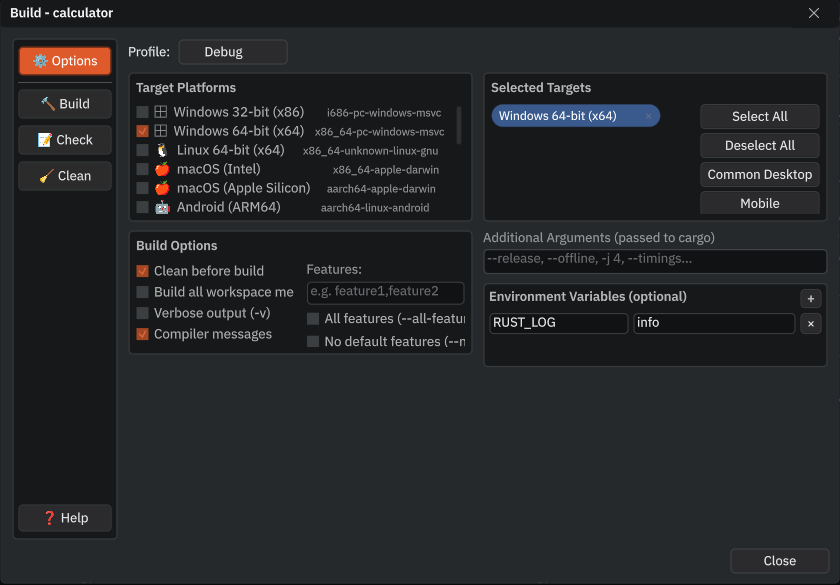
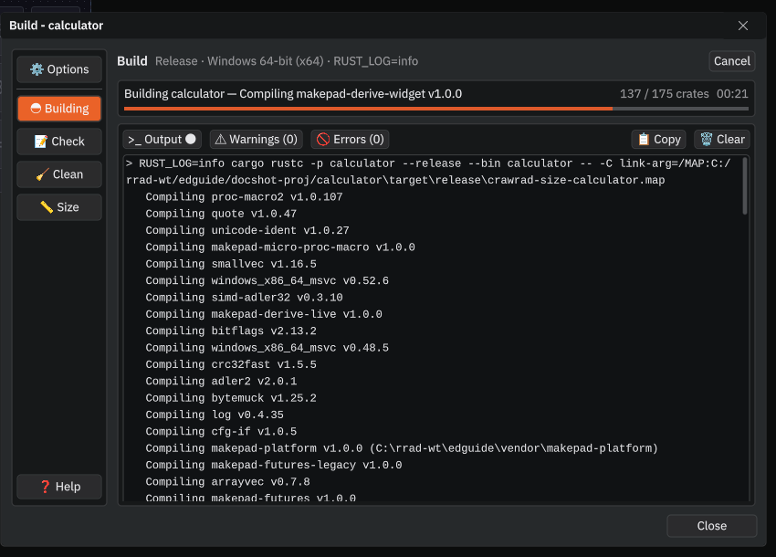
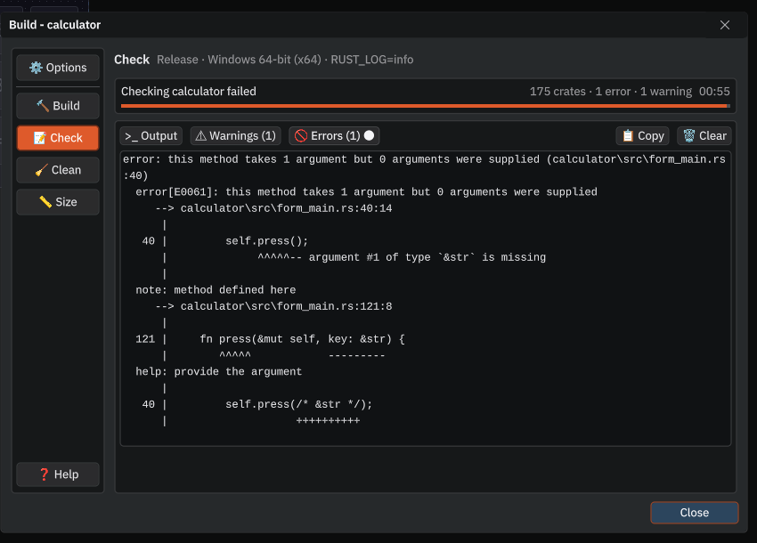
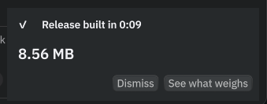
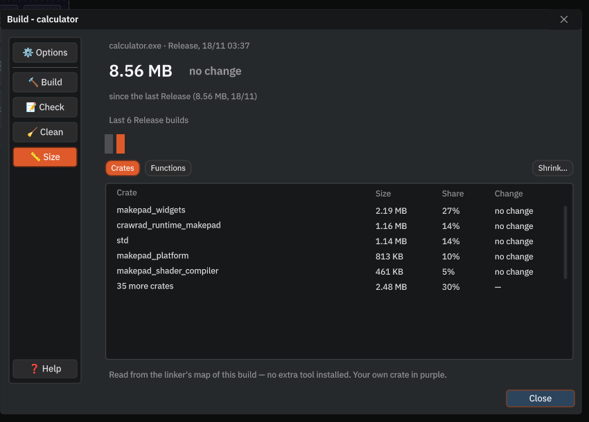
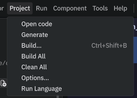
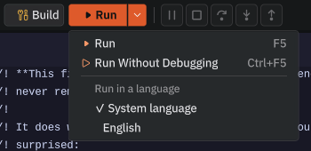
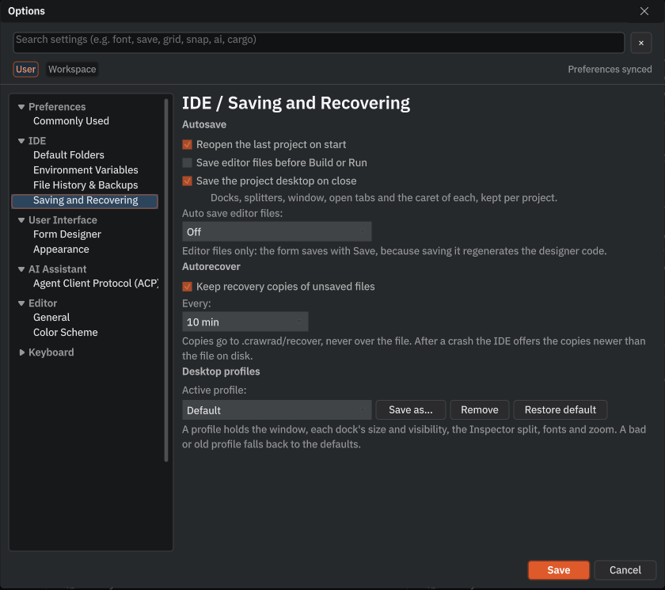

# Build your project

In CrawRAD, you can compile, type-check, clean, and profile your application binaries across multiple platforms directly from the **Build** window and toolbar.

Shortcuts are given for the default keymap, with the Classic keymap in parentheses.

## Open the Build window

Open the Build window to configure target platforms, compilation profiles, compiler options, and build commands for your project.

1. Open the project you want to build.
2. Select **Project > Build...** from the main menu, click **Build** on the top toolbar, or press <kbd>Ctrl</kbd>+<kbd>Shift</kbd>+<kbd>B</kbd> (<kbd>Shift</kbd>+<kbd>F9</kbd>).
3. The Build window opens with the title `Build - <project>` (displaying the open package name, or `my_app`).

You see the `Build - <project>` window, featuring a left action rail (`⚙ Options`, `🔨 Build`, `📝 Check`, `🧹 Clean`, `❓ Help`, and optionally `📏 Size`) with `⚙ Options` active, and the configuration pages on the right.

## Select compilation profile and target platforms

Choose whether to compile in Debug or Release mode and select the operating system and architecture targets for the build.

1. In the top configuration row, click the **Profile:** button to toggle between `Debug ▾` and `Release ▾`.
2. Under **Target Platforms**, check the box next to each platform to include:
   - `⊞  Windows 32-bit (x86)` (`i686-pc-windows-msvc`)
   - `⊞  Windows 64-bit (x64)` (`x86_64-pc-windows-msvc`)
   - `🐧  Linux 64-bit (x64)` (`x86_64-unknown-linux-gnu`)
   - `🍎  macOS (Intel)` (`x86_64-apple-darwin`)
   - `🍎  macOS (Apple Silicon)` (`aarch64-apple-darwin`)
   - `🤖  Android (ARM64)` (`aarch64-linux-android`)
   - `📱  iOS (ARM64)` (`aarch64-apple-ios`)
   - `🌐  WebAssembly (wasm32)` (`wasm32-unknown-unknown`)
3. Alternatively, click a quick button under **Selected Targets** to choose a preset:
   - Click **Select All** to select all eight platforms.
   - Click **Deselect All** to clear all target selections.
   - Click **Common Desktop** to select Windows 64-bit, Linux 64-bit, and macOS Apple Silicon.
   - Click **Mobile** to select Android ARM64 and iOS ARM64.
   - Click **Web** to select WebAssembly wasm32.
4. To remove an individual platform from the selection, click the `×` on its chip under **Selected Targets**.

You see the profile button toggle its label, checked targets update in the check list box, and removable chips appear under **Selected Targets** (or `No targets selected` displays when the list is empty).

## Set build options, features, and environment variables

Configure compiler flags, Cargo feature selections, extra command-line arguments, and process environment variables.

1. Under **Build Options**, check or uncheck the compiler switches:
   - Check **Clean before build** to remove previous build artifacts before starting.
   - Check **Build all workspace members** to compile every package in the workspace.
   - Check **Verbose output (-v)** to stream detailed compiler invocations.
   - Check **Compiler messages** to display compiler diagnostics.
2. In the **Features:** text field, type comma-separated feature names (placeholder `e.g. feature1,feature2`).
3. Check **All features (--all-features)** to activate every optional crate feature, or check **No default features (--no-default-features)** to disable default crate features.
4. In **Additional Arguments (passed to cargo)**, type extra command-line flags to forward to the compiler (placeholder `--release, --offline, -j 4, --timings...`).
5. Under **Environment Variables (optional)**, click the **+** button to add an environment variable row.
6. Type the variable name into the **Name** field (initial default `RUST_LOG` or `KEY`) and its value into the **Value** field (initial default `info` or `val`), or click the **×** button on any row to delete it.

You see the checkboxes show their checked states, the input fields display the entered features and arguments, and the environment table lists the active variable key-value rows.

## Run a build, check, or clean action

Start building, type-checking, or cleaning your project from the action rail.

1. In the left rail of the Build window, click:
   - **🔨 Build** to compile the project.
   - **📝 Check** to run type and borrow checking without generating binaries.
   - **🧹 Clean** to delete build artifacts for the current project.
2. If the project contains an open form or editor changes, CrawRAD saves files and generates form code before launching the Cargo process.
3. While the action runs, the button label updates to indicate active work and the window switches to the command page.
4. To abort the operation while running, click **Cancel** in the command header row.
5. Click **Close** in the footer or the `×` button in the title bar to dismiss the window.

You see the window switch to the command page showing the command header (`Build`, `Check`, or `Clean`), the metadata details, an animated progress bar with elapsed timer and step counter, and live output in the terminal panel.

## Inspect compiler output and diagnostics

Read the live build stream, view categorized warnings and errors, or jump directly to code errors.

1. On the command page, click **>_ Output** to view the raw compiler terminal stream.
2. Click **⚠ Warnings (0)** (displaying warning count with a dot `●` when selected) to filter only compiler warnings.
3. Click **🚫 Errors (0)** (displaying error count with a dot `●` when selected) to filter only compiler errors.
4. Click **📋 Copy** to copy the currently displayed console text to the system clipboard.
5. Click **🗑 Clear** to erase the log for the active command mode.
6. If the build finishes with errors, press <kbd>Ctrl</kbd>+<kbd>Shift</kbd>+<kbd>M</kbd> to open the **Problems** panel at the bottom of the IDE, or click an error in the list to navigate directly to the file and line in the code editor.

You see the terminal panel display formatted diagnostics, the status bar report `Status: ❌ Failed` or `Status: ✔ Success (Done.)`, and the code editor highlight error lines with colored squiggly bands and line numbers.

## Track builds with the floating Progress and Release card

Monitor background build status and review release summaries without keeping the Build window open.

1. Close the Build window while a build or run operation is active.
2. Look at the lower-right corner of the IDE where the floating progress card appears.
3. Observe the card's progress icon, headline, current package detail, elapsed clock, and running progress bar.
4. Click **Show output** on the card to reopen the Build window on the running command page, or click **Cancel** to abort the build task.
5. When a Release build finishes, the card transitions to the Release report card, showing a headline like `Release built in 0:42`, the total executable size, and the size delta compared to the previous release (for example, `+120 KB (mostly my_crate)`).
6. Click **See what weighs** to open the Build window directly to the Size page, or click **Dismiss** to hide the card.

You see a compact card floating in the corner displaying live build progress, which updates on release completion with final binary size, change delta, and action buttons.

When the size did not change, the card shows no delta line.

## Analyze executable size and crate weight (Release report)

Inspect the binary footprint of your application across release builds and identify which crates and functions contribute most to the executable size.

1. Run a build in **Release** profile so that CrawRAD records the binary size and symbol breakdown.
2. Open the Build window and click **📏 Size** (or **📏 Size •** if new release data is unviewed) on the left rail.
3. Read the executable name, build timestamp, total binary size, and comparison delta against previous releases.
4. Inspect the historical size bar chart showing the growth or reduction across recent release builds.
5. Review the crate table to see how much byte weight each crate adds to the binary, with the crate that grew most flagged with `▲`.
6. Scroll down to review the function symbol table to see the largest individual compiled routines.
7. Click **Shrink** to open the binary optimization recommendations dialog.

You see the `Size` view displaying the binary name and date, the size trend bar chart, the crate size breakdown table, the function symbol list, and the Shrink button.

On Windows, a release build of your own computer's target also asks the linker
for a map file, and the function list comes from it. On other systems, and for
other targets, the list is read from the program itself; it stays empty when the
program carries no symbol table.

## Build or clean an entire workspace

Compile or clean all packages across a multi-member Cargo workspace in a single step.

1. Open a workspace root containing multiple member packages.
2. To compile every workspace member, select **Project > Build All** from the main menu.
3. To remove compiled artifacts for all workspace members, select **Project > Clean All** from the main menu.
4. Alternatively, open the Build window, select the **⚙ Options** page, check **Build all workspace members**, and click **🔨 Build**.

You see CrawRAD execute `cargo build --workspace` or `cargo clean`, display the executed command in the status bar, and log progress for all workspace packages in the terminal panel.

## Run and debug from the toolbar Run split button

Launch your application under the debugger, run without debugging, or execute in a specific localized language directly from the toolbar.

1. Find the orange **Run** split button on the toolbar.
2. Click the primary **Run** button (<kbd>F5</kbd> (<kbd>F9</kbd>)) to generate forms, build the project, and launch the binary under the debugger.
3. Click the down-chevron arrow (`▾`) on the right side of the split button to open the run menu.
4. In the dropdown menu, select:
   - **Run** (<kbd>F5</kbd> (<kbd>F9</kbd>)) to run with debugging enabled.
   - **Run Without Debugging** (<kbd>Ctrl</kbd>+<kbd>F5</kbd> (<kbd>Ctrl</kbd>+<kbd>Shift</kbd>+<kbd>F9</kbd>)) to run without debugger hooks or breakpoint pauses.
5. Under the **Run in a language** header, click any configured language to run the application with that locale applied.

You see the toolbar split button open a popup menu showing execution options with shortcuts, followed by a separator and the localized language options with a checkmark on the active language.

## Save open files automatically before building

Automatically write all open editor buffers and documents to disk before every build or run action.

1. Select **Tools > Options...** (or press <kbd>Ctrl</kbd>+<kbd>,</kbd> in the Modern keymap).
2. In the list on the left, select **IDE > Saving and Recovering** (or **Commonly Used**, where the same switch is called **Files: Save before Build**).
3. Check **Save editor files before Build or Run**.
4. Click **OK** to save your preferences.

You see the checkbox enabled in the Options dialog. On subsequent builds, CrawRAD saves all modified open editor buffers to disk before starting Cargo.

<!-- SOURCES: crates/crawrad-ide/src/ide_app/dialogs/build.rs:40-484, crates/crawrad-ide/src/ide_app/build.rs:274-555, crates/crawrad-ide/src/ide_app/dialogs/dsl/tools_dialogs.rs:227-567, crates/crawrad-actions/src/lib.rs:3214-3588, crates/crawrad-project/src/build_fields.rs:1-195, crates/crawrad-project/src/build_settings.rs:1-450, crates/crawrad-project/src/build_report.rs:1-230, crates/crawrad-project/src/release_size.rs:800-1140, crates/crawrad-ide/src/ide_app/dialogs/dsl/options_dialog.rs:109-114, crates/crawrad-project/src/options.rs:350-400, crates/crawrad-actions/src/menu.rs:701-741 -->
