# Work in the code editor

The code editor provides language server intelligence powered by `rust-analyzer`, together with instant component introspection from form designs.

Shortcuts are given for the Modern keymap, the default,, with the Classic scheme in parentheses where they differ.

## Open a file and move between Design and Code

### Switch between Design and Code

Switch between the visual form designer canvas and the Rust code behind the form.

1. Open a form (`.crawform`) in your project.
2. Press <kbd>F12</kbd> (or click **Code** in the bottom center bar).
3. Press <kbd>F12</kbd> again (or click **Design** in the bottom center bar) to return to the canvas.

CrawRAD switches the center view between the visual form canvas and the form's `.rs` source code.

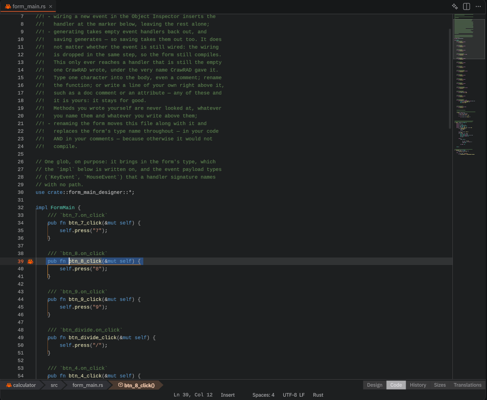

### View form source

Inspect the generated `.designer.rs` code that creates the components and properties declared in the form.

1. In either **Design** or **Code** view, press <kbd>Alt+F12</kbd> (or select **View > Toggle form source**).
2. Inspect the read-only generated Rust code.
3. Press <kbd>Alt+F12</kbd> again (or click **Design** in the bottom center bar) to return to the visual canvas.

The editor displays the generated form source with `Read only` indicated in the footer.

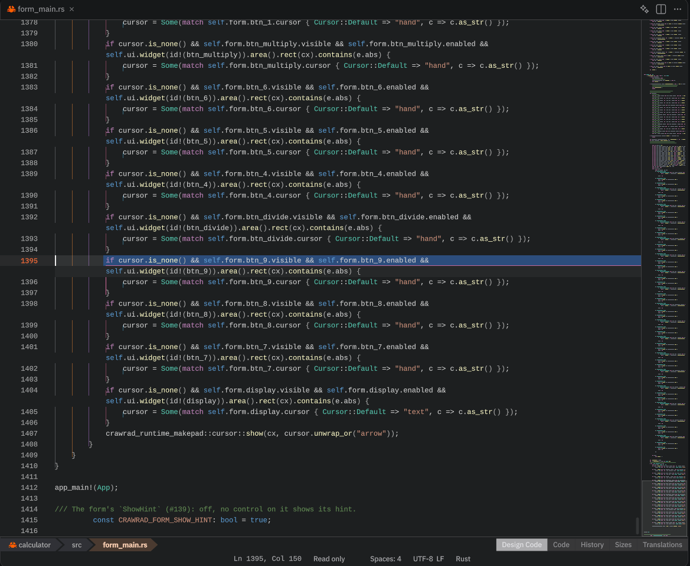

### Open a file with Quick Open

Open any project file quickly by typing its name or jump straight to a line.

1. Press <kbd>Ctrl</kbd>+<kbd>P</kbd> (<kbd>Ctrl</kbd>+<kbd>O</kbd>) or select **File > Quick Open...**.
2. Type part of a file name or path (for example, `main` or `src/form`). To jump directly to a line, append `:line` or `:line:col` (for example, `main.rs:42` or `:42`).
3. Use the <kbd>Up</kbd> and <kbd>Down</kbd> arrows to select a file from the filtered list.
4. Press <kbd>Enter</kbd> to open the file in an editor tab. Press <kbd>Esc</kbd> to dismiss.

A floating search palette appears at the top center; pressing <kbd>Enter</kbd> opens the selected file in an editor tab.

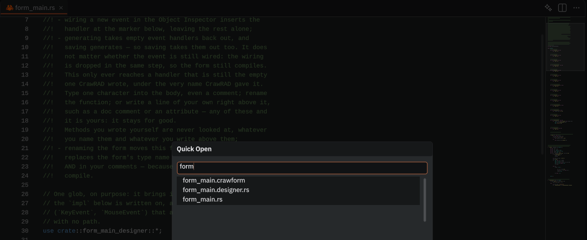

### Editor tabs and the unsaved dot

Switch between open source files and see which buffers have unsaved edits.

1. Click any tab in the editor tab strip above the code editor to bring that file to the front. When two open tabs share the same file name, notice the directory slice hint (for example, `inspector.rs  …/ide_app`).
2. Type an edit into the active buffer.
3. Look at the tab label: a dot appears next to the file name to indicate unsaved edits.
4. Press <kbd>Ctrl</kbd>+<kbd>S</kbd> to save the file, or click the **x** button on a tab to close it.

The active tab is highlighted, the unsaved dot clears immediately when saved, and closing a tab removes it from the strip.

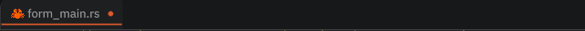

### Track location with breadcrumbs

See the file path hierarchy and the symbol enclosing the caret at a glance.

1. Open any Rust file in the code editor.
2. Place the caret inside a function, struct, enum, or method implementation.
3. Look at the breadcrumb bar directly below the editor area.

The breadcrumb displays the file icon (🦀 for `.rs`, 📄 for other files), folder segments, and the nearest symbol (a method icon with `name()` for functions, or a class icon with `name` for `impl`, `pub struct`, or `pub enum`).

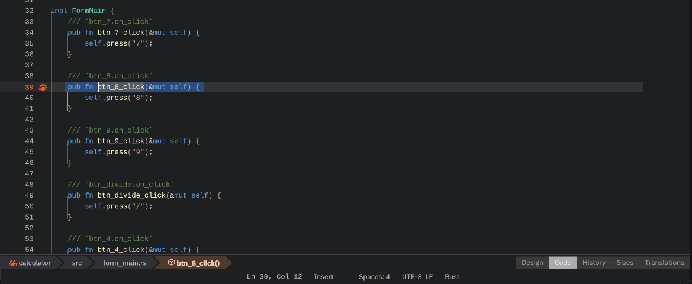

## Code completion, templates, signature help, and hover

### Code completion

Trigger contextual suggestions from form components and the language server at the caret.

1. Place the caret where you want to insert an identifier, and press <kbd>Ctrl</kbd>+<kbd>Space</kbd> (or type a period `.` after an identifier).
2. The completion popup displays in two phases:
   - **Phase 1 (Immediate)**: Form component properties and event fields list instantly.
   - **Phase 2 (Background)**: Semantic completions stream in from `rust-analyzer`.
3. Use the <kbd>Up</kbd> and <kbd>Down</kbd> arrows to navigate suggestions.
4. Press <kbd>Enter</kbd> or <kbd>Tab</kbd> to insert the selected completion. Press <kbd>Esc</kbd> to dismiss the popup.

A completion popup opens below the caret showing matching component fields and language server items with documentation.

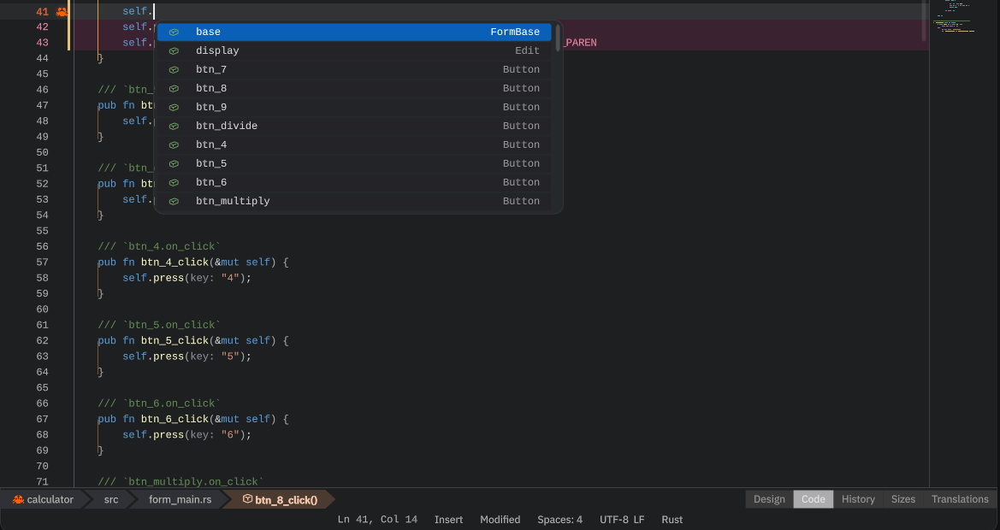

### Code templates

Insert ready-made code snippets at the caret and step through tab stops.

1. Place the caret on a new line or inside a code block.
2. Press <kbd>Ctrl</kbd>+<kbd>J</kbd> (or choose **Edit > Code Templates**).
3. Use <kbd>Up</kbd> and <kbd>Down</kbd> arrows to select a template from the list and press <kbd>Enter</kbd>.
4. Press <kbd>Tab</kbd> to jump between snippet placeholder stops, or press <kbd>Esc</kbd> to exit the snippet.

The template code expands at the caret with placeholders highlighted for quick typing.

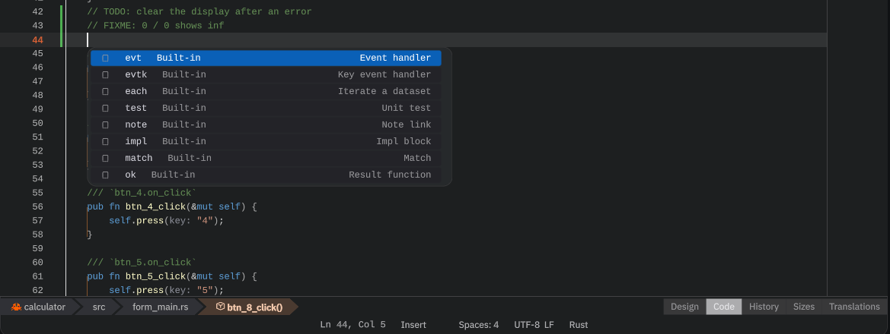

### Signature help and parameter hints

Display the function signature and highlight the active parameter while typing arguments.

1. Type `(` or `,` inside a function call's argument list, or press <kbd>Ctrl</kbd>+<kbd>Shift</kbd>+<kbd>Space</kbd> at any time.
2. Read the parameter card that appears above the call.
3. Notice the parameter corresponding to the current caret position highlighted in Rust orange.
4. Press <kbd>Esc</kbd> to dismiss the signature card.

A parameter card floats over the caret showing the full function signature with the active argument highlighted in Rust orange.

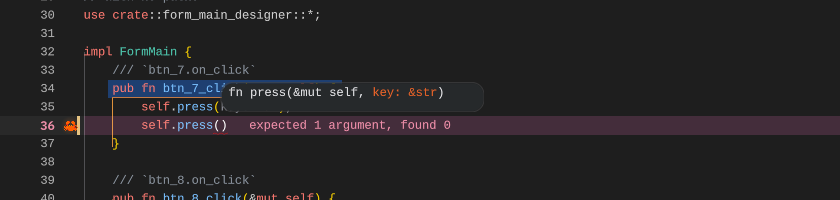

### Hover documentation

View type definitions, function signatures, and doc comments for any symbol.

1. Rest your mouse pointer over any identifier, or place the caret on it and press <kbd>Ctrl</kbd>+<kbd>K</kbd>.
2. Read the inferred type, signature, and rustdoc comments displayed in the card.
3. Move the caret or press <kbd>Esc</kbd> to close the hover card.

A hover card appears displaying inferred types, full function signatures, and rustdoc comments.

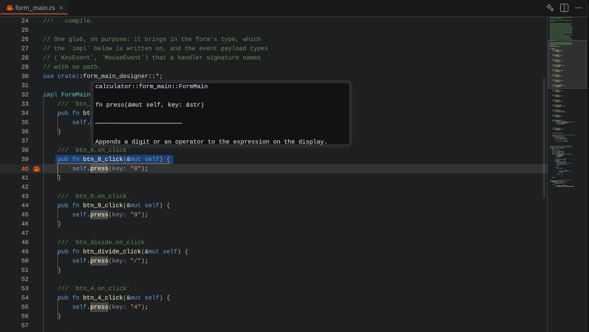

## Go to definition, back and forward, find references, and rename

### Go to definition

Jump directly to where a function, struct, variable, or module is declared.

1. Place the caret on any symbol name.
2. Press <kbd>Ctrl</kbd>+<kbd>F12</kbd> (<kbd>Alt</kbd>+<kbd>Up</kbd>), or hold <kbd>Ctrl</kbd> and click the symbol name.

CrawRAD opens the target file and positions the caret on the declaration.

### Navigate back and forward

Retrace your navigation history after jumping to definitions.

1. After jumping to a definition, press <kbd>Alt</kbd>+<kbd>Left</kbd> (or select **Go > Go Back**).
2. To navigate forward again to where you jumped from, press <kbd>Alt</kbd>+<kbd>Right</kbd> (or select **Go > Go Forward**).

The caret jumps back to your previous editing position, and forward again when requested.

### Find all references

Locate every usage of a symbol across the workspace.

1. Place the caret on an identifier.
2. Press <kbd>Shift</kbd>+<kbd>Alt</kbd>+<kbd>F12</kbd> (<kbd>Ctrl</kbd>+<kbd>Shift</kbd>+<kbd>Enter</kbd>), or select **Go > Find References**.
3. In the **References** panel, on the left, read the uses grouped by file, with the line number and the line's text.
4. Click any row in the **References** panel to jump directly to that usage.

The **References** panel opens on the left, grouping every reference by file with line numbers and preview text while explicitly marking references in generated form source files.

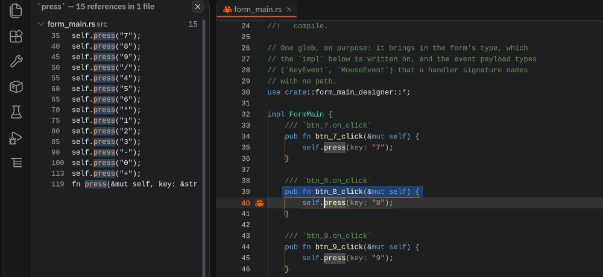

### Rename a symbol

Rename a variable, function, struct, or module safely across all workspace files in memory.

1. Place the caret on the name and press <kbd>F2</kbd> (<kbd>Ctrl</kbd>+<kbd>Shift</kbd>+<kbd>E</kbd>), or select **Refactor > Rename Symbol**.
2. Type the new name and press <kbd>Enter</kbd> (or click **Preview**) to see every change. Nothing is applied yet.
3. Click **Apply** to rename in every affected file, in memory.
4. Press <kbd>Ctrl</kbd>+<kbd>S</kbd> or <kbd>Ctrl</kbd>+<kbd>Shift</kbd>+<kbd>S</kbd> to save modified files to disk.

A rename dialog opens with a proposed change preview, then updates all affected buffers in memory.

> [!NOTE]
> Components and event handlers declared on forms cannot be renamed with Rename Symbol in the code editor. Rename them in the **Object Inspector** so form designs and code handlers stay in sync.

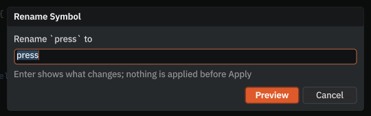

## Code actions with the crab

Apply compiler quick fixes, trait implementations, imports, and AI explanations suggested for the current line.

1. Look at the line number gutter: when `rust-analyzer` has a suggestion or diagnostic fix for your line, a small crab appears next to the line numbers. When it pulses, the first action is a preferred quick fix.
2. Press <kbd>Ctrl</kbd>+<kbd>.</kbd> (or click the crab).
3. In the popup menu, review available code actions (such as adding missing imports, implementing missing trait members, or converting expressions).
4. Click an action or press <kbd>Enter</kbd> to apply it.

A quick fix menu opens displaying available actions; applying an action updates the buffer immediately. Code actions that would alter generated form source files (`.designer.rs`) are automatically refused.

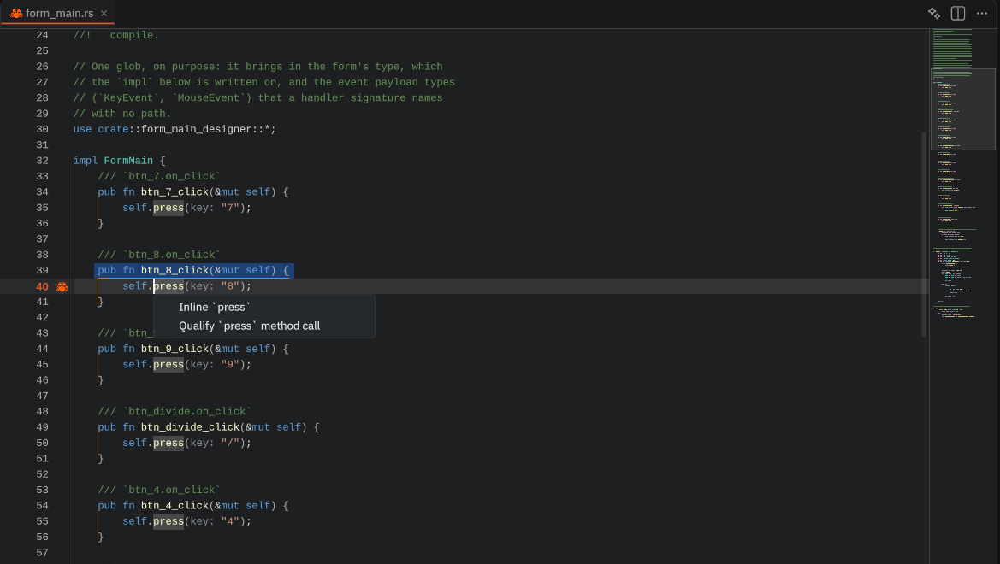

## Notes, documentation, and comments

### Add documentation

Write public documentation in rustdoc format stored as a sidecar note.

1. Place the caret on a `fn`, `struct`, `enum`, `trait`, or `const` declaration.
2. Press <kbd>Ctrl</kbd>+<kbd>Alt</kbd>+<kbd>D</kbd> (or select **Edit > Add documentation**).
3. Type your Markdown content in the dialog, or click section buttons (**Summary**, **# Examples**, **# Errors**, **# Panics**, **# Safety**) to insert recommended sections.
4. Click **Save**.

CrawRAD writes `#[note("<id>")]` above the item, saves the Markdown content to `.crawrad/notes/<id>.md`, and displays a blue page icon in the gutter.

### Add an architectural note

Record private developer context, architectural reasons, and design decisions directly attached to a line of code.

1. Place the caret on any code line.
2. Press <kbd>Ctrl</kbd>+<kbd>Alt</kbd>+<kbd>N</kbd> (or select **Edit > Add note**).
3. Type a title, tags, and Markdown explanation in the dialog.
4. Click **Save**.

CrawRAD appends `// [crawrad:note#<id>]` to the line, stores the note under `.crawrad/notes/<id>.md`, and places an amber folded note icon in the gutter.

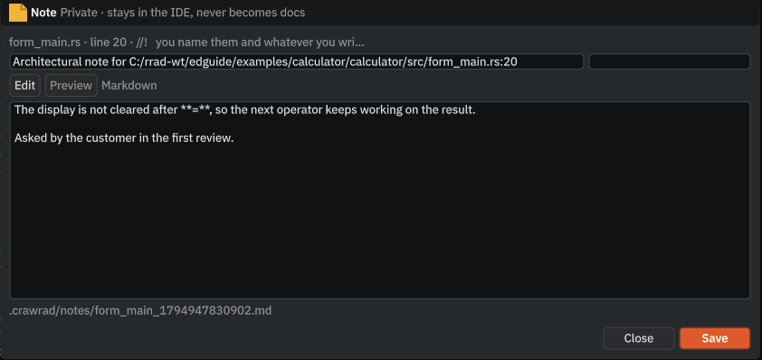

### Add a review comment

Leave a short review remark or task comment on a line that can be resolved or reopened.

1. Place the caret on any line of code.
2. Press <kbd>Ctrl</kbd>+<kbd>Alt</kbd>+<kbd>M</kbd> (or select **Edit > Add comment**).
3. Type your review comment in the dialog and click **Save**.
4. When the task is complete, click the teal gutter icon to reopen the comment and click **Resolve**.

CrawRAD appends `// [crawrad:comment#<id>]` to the line, places a teal chat bubble icon in the gutter, and badges the comment as **Open** or **Resolved**.

### Manage notes with the popup and gutter icons

Open the unified notes popup or click gutter icons to view and edit attached notes.

1. Place the caret on any code line and press <kbd>Ctrl</kbd>+<kbd>Shift</kbd>+<kbd>N</kbd> (or select **Tools > Notes...**).
2. Review the **Notes** popup showing the line number and symbol signature, listing **Add documentation**, **Add note**, and **Add comment** with their status.
3. Select any option to open that dialog.
4. In the gutter, click any existing note icon (blue for documentation, amber for notes, teal for comments) to reopen and edit its dialog.

A compact popup menu opens at the caret showing note options; clicking any gutter icon reopens the corresponding sidecar note dialog. See [Add notes and documentation to your code](notes.md) for full dialog details.

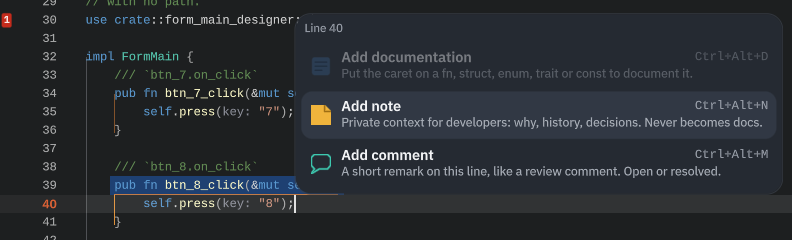

## Breakpoints and log points

### Set or remove a breakpoint

Stop execution at a specific line of code when running under the debugger.

1. Place the caret on any executable line of code.
2. Press <kbd>F9</kbd> (<kbd>F5</kbd>), or click in the glyph margin to the left of the line number (or select **Run > Toggle Breakpoint**).
3. Press <kbd>F9</kbd> (<kbd>F5</kbd>) again or click the red dot to remove the breakpoint.

A solid red dot appears in the gutter glyph margin on that line; clicking or toggling again removes the dot.

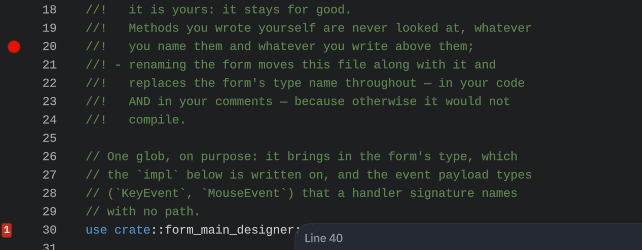

### Track the execution point

Identify where the debugger has paused execution.

1. Set a breakpoint on a line and run the program under the debugger (<kbd>F5</kbd> (<kbd>F9</kbd>)).
2. Trigger the action that executes that line.
3. Inspect the code editor when the application suspends.

A bright yellow arrow appears in the gutter glyph margin over the breakpoint dot, and a yellow highlight band stretches across the stopped line.

## Bookmarks

### Set or clear a numbered bookmark

Place or clear a persistent numbered bookmark on any line of code.

1. Place the caret on the line you want to bookmark.
2. Press <kbd>Ctrl</kbd>+<kbd>Shift</kbd>+<kbd>1</kbd> through <kbd>Ctrl</kbd>+<kbd>Shift</kbd>+<kbd>9</kbd>.
3. To remove the bookmark, place the caret on the same line and press the same chord again.

A small red flag appears at the left edge of the gutter glyph margin with the bookmark number (1–9) rendered inside it.

### Jump to a numbered bookmark

Move the caret instantly to a previously set numbered bookmark in the file.

1. From anywhere in the active file, press <kbd>Ctrl</kbd>+<kbd>1</kbd> through <kbd>Ctrl</kbd>+<kbd>9</kbd>.

The editor scrolls smoothly and positions the caret directly on that numbered bookmark's line.

## Find, find and replace, and go to line

### Find in editor

Search for occurrences of text in the active editor buffer.

1. Press <kbd>Ctrl</kbd>+<kbd>F</kbd>.
2. Type the search text in the find bar at the top left of the editor.
3. Press <kbd>Enter</kbd> (or click **>**) to jump to the next occurrence, or <kbd>Shift</kbd>+<kbd>Enter</kbd> (or click **<**) for the previous occurrence.
4. Press <kbd>Esc</kbd> (or click the **x** button) to dismiss the find bar.

The floating find bar appears, highlights matching occurrences, and shows match counts (such as `1/4`).

### Find and replace

Replace single or all occurrences of a search term in the active file.

1. Press <kbd>Ctrl</kbd>+<kbd>H</kbd> (<kbd>Ctrl</kbd>+<kbd>R</kbd>), or click the **>** button at the left of the open find bar.
2. Type the replacement text in the lower input field.
3. Click **Replace** to replace the current match, or **All** to replace every match in the file.

The find bar expands to reveal the replace row with input field and action buttons, updating matches live.

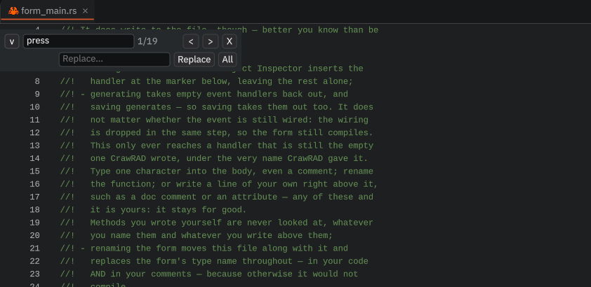

### Find next and previous

Navigate through search occurrences using dedicated function keys.

1. With a search term entered, press <kbd>F3</kbd> to jump to the next matching occurrence.
2. Press <kbd>Shift</kbd>+<kbd>F3</kbd> to jump to the previous matching occurrence.

The editor selection cycles forward or backward through matched text across the document.

### Go to line and column

Jump the caret directly to a specific line number and optional column.

1. Press <kbd>Ctrl</kbd>+<kbd>G</kbd> (<kbd>Alt</kbd>+<kbd>G</kbd>). The **Go to Line / Column** dialog opens.
2. In the box, type the line number (for example, `120`), or line and column separated by a colon (such as `120:15`).
3. Press <kbd>Enter</kbd> or click **Go**.

The editor scrolls immediately to the requested line and places the caret at the specified column.

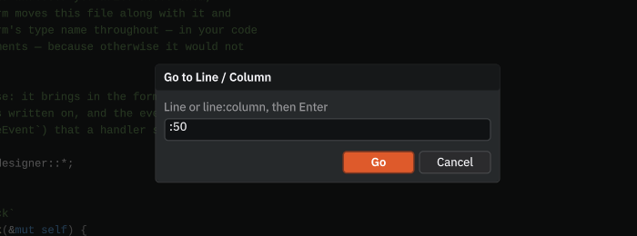

## Editing lines

### Comment or uncomment lines

Toggle line comments across the current line or selection.

1. Place the caret on a line or select multiple lines.
2. Press <kbd>Ctrl</kbd>+<kbd>/</kbd> or <kbd>Ctrl</kbd>+<kbd>;</kbd> (<kbd>Ctrl</kbd>+<kbd>Shift</kbd>+<kbd>C</kbd>).

CrawRAD inserts or removes `// ` at the minimum indentation level across all selected lines.

### Move lines up or down

Shift the current line or selected block of lines vertically.

1. Place the caret on a line or select a range of lines.
2. Press <kbd>Alt</kbd>+<kbd>Up</kbd> (<kbd>Ctrl</kbd>+<kbd>Alt</kbd>+<kbd>Up</kbd>) to move the lines upward.
3. Press <kbd>Alt</kbd>+<kbd>Down</kbd> (<kbd>Ctrl</kbd>+<kbd>Alt</kbd>+<kbd>Down</kbd>) to move the lines downward.

The entire line or block moves past adjacent code lines, retaining cursor position and indentation.

### Duplicate lines

Make an exact copy of the current line or selection above or below.

1. Place the caret on a line or select multiple lines.
2. Press <kbd>Shift</kbd>+<kbd>Alt</kbd>+<kbd>Up</kbd> to duplicate the lines upward.
3. Press <kbd>Shift</kbd>+<kbd>Alt</kbd>+<kbd>Down</kbd> to duplicate the lines downward.

A duplicate of the line or block appears immediately above or below the original.

### Delete line

Delete the entire line under the caret in a single keystroke.

1. Place the caret anywhere on the line you want to remove.
2. Press <kbd>Ctrl</kbd>+<kbd>Shift</kbd>+<kbd>K</kbd> (<kbd>Ctrl</kbd>+<kbd>Y</kbd>).

The entire line disappears and the lines below shift up to take its place.

### Select next occurrence (multi-cursor)

Add multiple carets by selecting successive matching words for simultaneous editing.

1. Place the caret inside a word or select a text span.
2. Press <kbd>Ctrl</kbd>+<kbd>D</kbd> (<kbd>Ctrl</kbd>+<kbd>Shift</kbd>+<kbd>D</kbd>) to select the current word.
3. Press <kbd>Ctrl</kbd>+<kbd>D</kbd> (<kbd>Ctrl</kbd>+<kbd>Shift</kbd>+<kbd>D</kbd>) again to find and select the next occurrence in the file.
4. Type to edit all selected occurrences simultaneously, or press <kbd>Esc</kbd> to return to a single cursor.

Multiple selections and blinking cursors appear across matching words, updating all instances at once as you type.

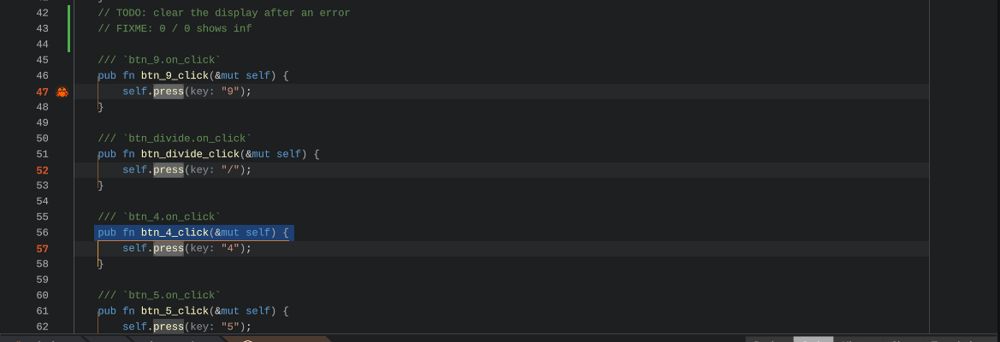

### Fold and unfold code blocks

Collapse or expand nested code blocks between braces to simplify reading long functions.

1. Place the caret inside any block enclosed by braces `{ ... }`.
2. Press <kbd>Ctrl</kbd>+<kbd>Shift</kbd>+<kbd>[</kbd> to fold the block.
3. Press <kbd>Ctrl</kbd>+<kbd>Shift</kbd>+<kbd>]</kbd> to unfold the block.

The inner body of the block collapses into a single line or expands back to its full multiline structure.

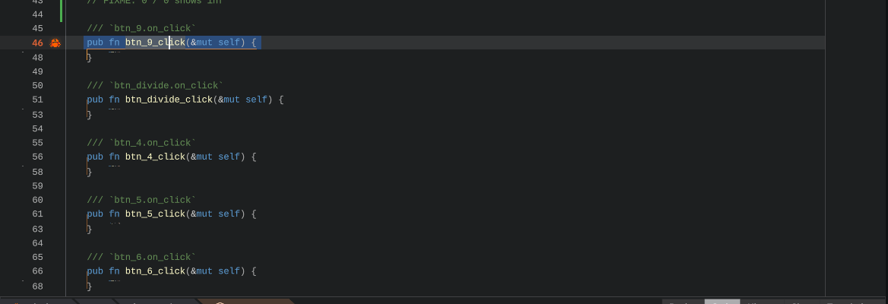

### Format document

Reformat the entire file automatically according to standard Rust formatting guidelines.

1. Open any editable `.rs` file in the editor.
2. Press <kbd>Shift</kbd>+<kbd>Alt</kbd>+<kbd>F</kbd> (<kbd>Ctrl</kbd>+<kbd>D</kbd>), or select **Refactor > Format Document**.

The entire file is formatted with `rustfmt` via `rust-analyzer`; pressing <kbd>Ctrl</kbd>+<kbd>Z</kbd> undoes all formatting in one step.

### Word motion and file navigation

Jump across word boundaries and file boundaries using rapid navigation chords.

1. Press <kbd>Ctrl</kbd>+<kbd>Left</kbd> to jump the caret to the start of the word on the left.
2. Press <kbd>Ctrl</kbd>+<kbd>Right</kbd> to jump the caret to the end of the word on the right.
3. Press <kbd>Ctrl</kbd>+<kbd>Home</kbd> to jump to the very beginning of the file.
4. Press <kbd>Ctrl</kbd>+<kbd>End</kbd> to jump to the very end of the file.
5. Hold <kbd>Shift</kbd> while pressing any of these chords to extend the selection.

The caret leaps cleanly across whitespace, identifiers, or symbol groups.

## Inlay hints

Toggle inline type annotations and parameter names inferred by `rust-analyzer`.

1. Open any Rust file in the editor.
2. Choose **View > Inlay Hints** from the top menu.
3. Observe subtle grey type hints appearing inline next to variable bindings and function arguments.
4. Select **View > Inlay Hints** again to toggle them off.

Type and parameter hints appear directly within code lines in grey without altering file text on disk.

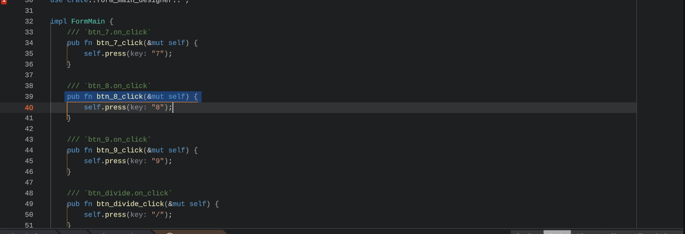

## Check errors in the Problems panel

Review all build errors, panics, warnings, and compiler diagnostic messages across workspace files.

1. Press <kbd>Ctrl</kbd>+<kbd>Shift</kbd>+<kbd>M</kbd> (or select **View > Problems**).
2. Review diagnostics listed with their severity icon, file name, and line location.
3. Click category chips at the top to filter items:
   - **Errors**: what stops the build.
   - **Warnings**: what the compiler warns about.
   - **Full output**: everything the build printed.
4. Click any problem row to jump straight to that file and line in the editor.

The **Problems** panel docks at the bottom, providing filtered problem counts and direct links to error locations.

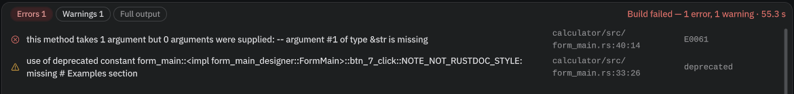

## Change bars

Track lines added or modified during the current editing session using gutter change bars.

1. In any saved file, edit a line of code or press <kbd>Enter</kbd> to add a new line.
2. Look at the margin immediately to the right of the line numbers: a **yellow bar** indicates unsaved changes on that line.
3. Press <kbd>Ctrl</kbd>+<kbd>S</kbd> to save the file.
4. Look at the change bar again: it turns **green**, indicating lines added or modified during this session that are now safely saved to disk.

A thin 3-pixel vertical bar beside each edited line clearly distinguishes unsaved (yellow) from saved (green) edits.

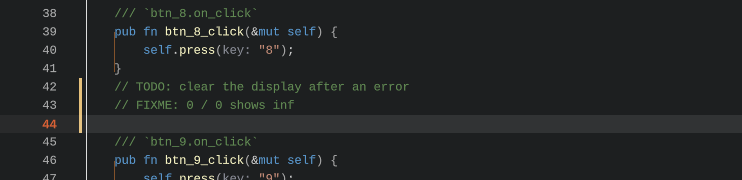

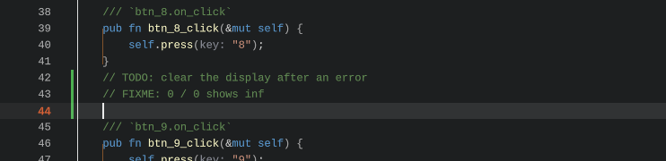

## When a file changes on disk

When an open file is modified on disk outside CrawRAD, the editor detects the change and protects your work.

- If you have no unsaved edits in the file, CrawRAD reloads it from disk automatically. The status bar confirms that the file reloaded (`<file> reloaded — changed on disk`) and preserves your caret position.
- If you have unsaved edits in the buffer, nothing is overwritten. The status bar warns that you have unsaved edits, and a notification bar appears above the editor showing `<file> changed on disk, and you have unsaved edits here.`

To resolve the conflict when you have unsaved edits:

1. Click **Keep mine** to keep your editor buffer and dismiss the bar. Your version remains, and saving writes it over the disk file.
2. Click **Reload from disk** to discard your unsaved edits and reload the copy from disk.
3. Click **Compare** to open an inline diff review comparing your buffer with the disk copy. In the review bar, accepting takes the disk version, and rejecting keeps yours.

You see the notification bar above the code editor displaying the conflict warning and the three decision buttons, while your unsaved edits remain safe in the buffer.

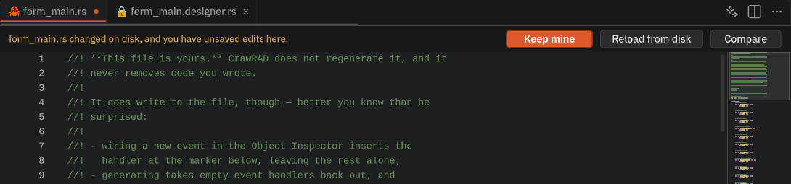

## Local history

Inspect snapshots of saved or reloaded files and restore individual change blocks or complete files.

1. While viewing any source file in the editor, click the **History** tab in the center tabs bar at the bottom (or click an entry under **Timeline** in the Explorer).
2. In the history entries list, select a snapshot (labeled with local time, relative date such as "today", origin "**Save**" or "**External**", and line count).
3. Review the side-by-side diff comparing the historical snapshot on the left with your current buffer on the right.
4. Click **Previous** or **Next** to step through diff change blocks.
5. Click **Restore this block** to bring back only the selected block into your current buffer, or click **Revert to this version** to restore the whole version.
6. Switch back to **Code** view (<kbd>F12</kbd> or click the **Code** tab) to continue editing, or press <kbd>Ctrl</kbd>+<kbd>Z</kbd> to undo the restore.

The center view displays the side-by-side **History** diff with entries list and block navigation; restoring updates the buffer with an undo step on the stack.

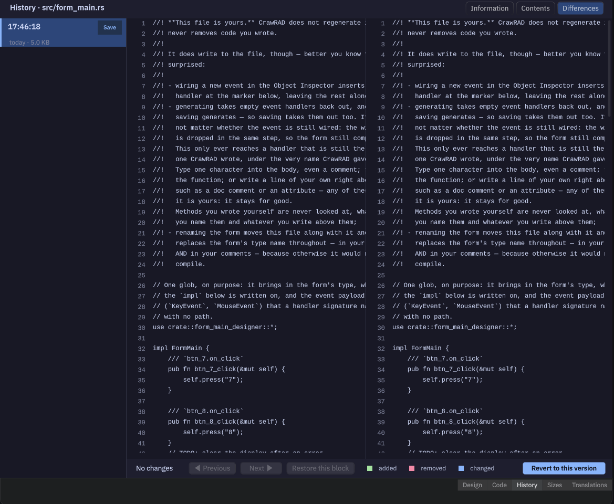

<!-- SOURCES: crates/crawrad-host/src/editor_tabs.rs:1-175, crates/crawrad-host/src/breadcrumb.rs:1-67, crates/crawrad-host/src/quick_open.rs:1-92, crates/crawrad-actions/src/lib.rs:844-907, crates/crawrad-actions/src/lib.rs:1700-1810, crates/crawrad-actions/src/lib.rs:2624-3200, crates/crawrad-host/src/editor_chords.rs:1-185, crates/crawrad-host/src/line_edits.rs:1-190, crates/crawrad-host/src/word_motion.rs:1-115, crates/crawrad-host/src/find.rs:1-136, crates/crawrad-host/src/breakpoints.rs:1-201, crates/crawrad-host/src/bookmarks.rs:1-83, crates/crawrad-host/src/history.rs:1-196, crates/crawrad-host/src/history_view.rs:1-393, crates/crawrad-project/src/note_dialog.rs:1-330, crates/crawrad-project/src/sidecar_notes.rs:1-240, crates/crawrad-ide/src/ide_app/editor/buffer.rs:1-352, crates/crawrad-ide/src/ide_app/editor/keys.rs:1-416, crates/crawrad-ide/src/ide_app/editor/find.rs:1-187, crates/crawrad-ide/src/ide_app/editor/breakpoints.rs:1-56, crates/crawrad-ide/src/ide_app/editor/complete.rs:1-100, crates/crawrad-ide/src/ide_app/editor/signature.rs:1-60, crates/crawrad-ide/src/ide_app/editor/item_doc.rs:1-60, crates/crawrad-ide/src/ide_app/editor/code_actions.rs:1-140, crates/crawrad-ide/src/ide_app/editor/line_marks.rs:1-69, crates/crawrad-ide/src/ide_app/editor/change_bars.rs:1-33, crates/crawrad-ide/src/ide_app/disk_watch.rs:1-138, crates/crawrad-ide/src/ide_app/panels/design.rs:228-238, crates/crawrad-ide/src/ide_app/history.rs:1-164, crates/crawrad-ide/src/ide_app/references.rs:1-60, crates/crawrad-ide/src/ide_app/rename.rs:1-60, crates/crawrad-ide/src/ide_app/problems.rs:1-60, crates/makepad-code-editor/src/gutter.rs:1-365, crates/makepad-code-editor/src/gutter_mark.rs:1-165, crates/makepad-code-editor/src/line_mark.rs:1-35, crates/makepad-code-editor/src/note_icon.rs:1-83, crates/makepad-code-editor/src/note_anchor.rs:1-115, crates/crawrad-ext-todo/src/lib.rs:1-173 -->
