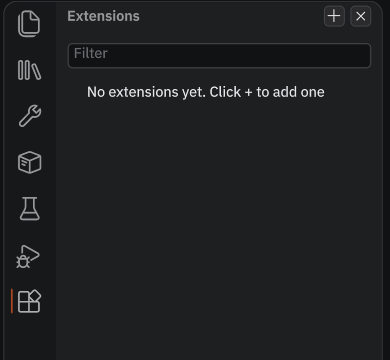

# Install and manage extensions

Extensions expand CrawRAD with custom capabilities, such as automated tools, code lens annotations, gutter marks, and custom side panel trees.

An extension is a directory that contains a manifest (`extension.json` or `manifest.json`), an entrypoint script or executable, and any assets it requires.

Extensions are installed once per user on your machine. On Windows, they are stored in `%APPDATA%\CrawRAD\extensions\<id>@<version>\` (or `~/.crawrad/extensions/<id>@<version>/` on other operating systems). Each project tracks which extensions it activates by listing their IDs and versions in `.crawrad/extensions.json` in the project root. Older projects that store extensions directly in `.crawrad/extensions/<id>/` continue to scan and load automatically.

## Open the Extensions panel

1. Click the **Extensions** icon (the blocks icon) in the leftmost activity rail.
2. Alternatively, press <kbd>Ctrl</kbd>+<kbd>Shift</kbd>+<kbd>P</kbd>, type `Toggle panel`, press <kbd>Enter</kbd>, and choose `extensions`.

You see the **Extensions** panel open in the dock with a search filter, an install button (**+**) in the header, an **Installed** section listing active extensions, and custom tree views provided by installed extensions. While nothing is installed, the panel reads `No extensions yet. Click + to add one`.

## Install an extension

You can install an extension into the current project while CrawRAD is running, with no restart required.

1. In the header of the **Extensions** panel, click the install button (**+**).
2. In the folder picker dialog, select the directory containing the extension's `manifest.json` (or `extension.json`).
3. Alternatively, an agent can install an extension over MCP by calling `project.install_extension` with the directory path.

To try it, install one of the samples that ship with the source: `crates/crawrad-ext-todo/extension` (a TODO list view) or `examples/extensions/formatter`.

CrawRAD copies the extension into your user store at `%APPDATA%\CrawRAD\extensions\<id>@<version>\` (if not already present), adds an entry to `.crawrad/extensions.json` in your project, registers its commands and views, and starts its process immediately.

You see the extension appear in the **Installed** list with its name and version, and its contributed tree views and commands become available instantly.

## Uninstall an extension

Uninstalling removes an extension from your project without affecting other projects that share the installed version.

1. Open the **Extensions** panel from the activity rail.
2. In the **Installed** list, locate the extension you want to remove.
3. Click the uninstall button (the trash icon) next to the extension name.
4. Alternatively, an agent can uninstall an extension over MCP by calling `project.uninstall_extension` with the extension ID.

CrawRAD stops the extension process, unregisters all contributed actions, views, and line marks, and removes the extension reference from `.crawrad/extensions.json`. The extension files remain in your user extensions store so other projects can use them (legacy project-local folders in `.crawrad/extensions/<id>/` are deleted).

You see the extension removed from the **Installed** list and its views disappear immediately from the panel without restarting CrawRAD.

<!-- SOURCES: crates/crawrad-extension-host/src/install.rs:1-221, crates/crawrad-extension-host/src/host.rs:106-200, crates/crawrad-ide/src/ide_app/extension_views.rs:1-236, crates/crawrad-project/src/rail.rs:55-76, crates/crawrad-project/src/icons.rs:84-109, crates/crawrad-project/src/icons.rs:298, crates/crawrad-project/src/icons.rs:362, crates/crawrad-mcp/src/tools.rs:1060-1095, crates/crawrad-actions/src/capability.rs:565-644 -->
