# Set the IDE options

The **Options** dialog (**Tools > Options...**) allows you to customize IDE preferences, workspace defaults, editor typography, color themes, keyboard shortcut schemes, visual designer grid settings, and AI assistant configurations.

## Open the Options dialog

The Options dialog centralizes all IDE-wide preferences, designer parameters, editor behaviors, and agent configurations.

1. To open the dialog from the top menu bar, select **Tools > Options...**, or press <kbd>Ctrl</kbd>+<kbd>,</kbd> (no shortcut in Classic).
2. To open the dialog from the command palette, press <kbd>Ctrl</kbd>+<kbd>Shift</kbd>+<kbd>P</kbd> (<kbd>Ctrl</kbd>+<kbd>Shift</kbd>+<kbd>P</kbd>), type `Options...`, and press <kbd>Enter</kbd>.
3. Alternatively, click the gear icon at the bottom of the Activity Rail, or click the **Settings** gear button in the Chat panel header.

You see the modal `Options` dialog open displaying the top search bar with scope tabs, the category tree on the left, the settings pane on the right, and the `Save` and `Cancel` buttons in the footer.

## Search settings and filter by scope

The search box and scope tabs let you quickly find any configuration setting across all pages without navigating the tree.

1. Click the search input box (`Search settings (e.g. font, save, grid, snap, ai, cargo)`).
2. Type a keyword such as `font`, `line`, `save`, `grid`, `ai`, or `key`.
3. To clear the query and restore the full category tree, click the **×** button next to the search field.
4. Click the **User** tab to view global user preferences or the **Workspace** tab to view settings scoped to the active project.

You see matching options appear dynamically under `Search Settings: "<query>"`, or `No settings found matching your search query.` when no options match the search text.

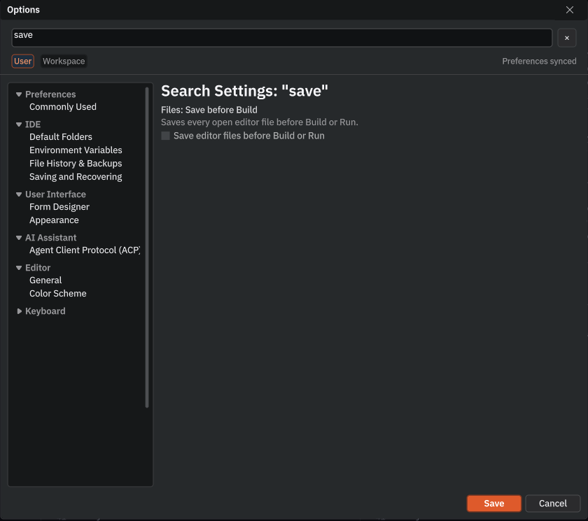

## Preferences: Commonly Used

The Commonly Used page aggregates the most frequently changed settings from different areas of the IDE in one place.

1. In the left tree under **Preferences**, click **Commonly Used**.
2. To change editor font scale, pick a size from the **Editor: Font Size** dropdown (choices: `9 pt` to `20 pt`, default: `11 pt`).
3. To toggle editor line numbers, click the **Editor: Line Numbers** checkbox (`Show line numbers in editor margin`, default: on).
4. Highlight: To save open files before building, click the **Files: Save before Build** checkbox (`Save editor files before Build or Run`, default: off).
5. Highlight: To configure designer alignment, toggle **Display grid** (default: on) and **Snap to grid** (default: on) under **Designer: Grid & Snap**.
6. Highlight: To choose your AI agent service, select an option from the **AI Assistant: Provider** dropdown (default: the active ACP agent provider).

You see a single unified settings page showing the five most frequently adjusted controls with their scopes and explanatory descriptions.

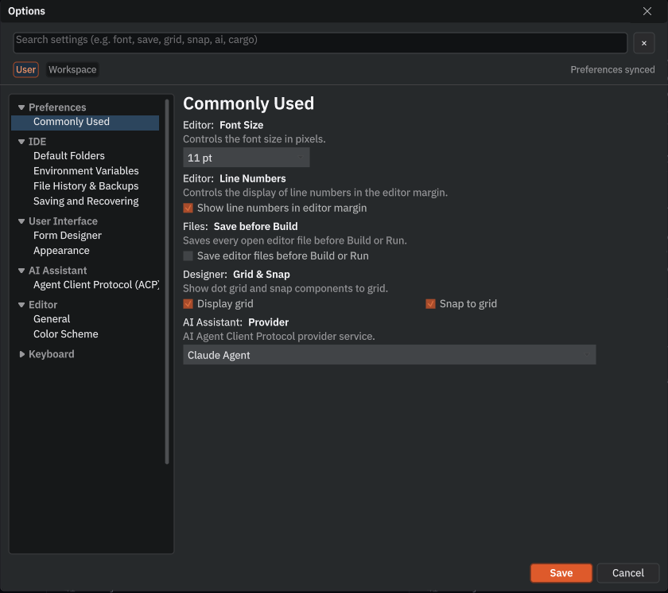

## IDE: Default Folders

The Default Folders page configures where new projects and workspaces are created and opened by default.

1. In the left tree under **IDE**, click **Default Folders**.
2. In the **Default Projects Directory:** field, type the absolute path where projects should be located.
3. Alternatively, click **Browse...** to select a directory using the system folder picker.
4. Leave the field empty (the default: empty / `None`) to use the working directory from which CrawRAD was launched.

You see the heading `Default Folders`, the subtitle `Specify default directories for creating and searching Cargo projects.`, the path input box, and the `Browse...` button.

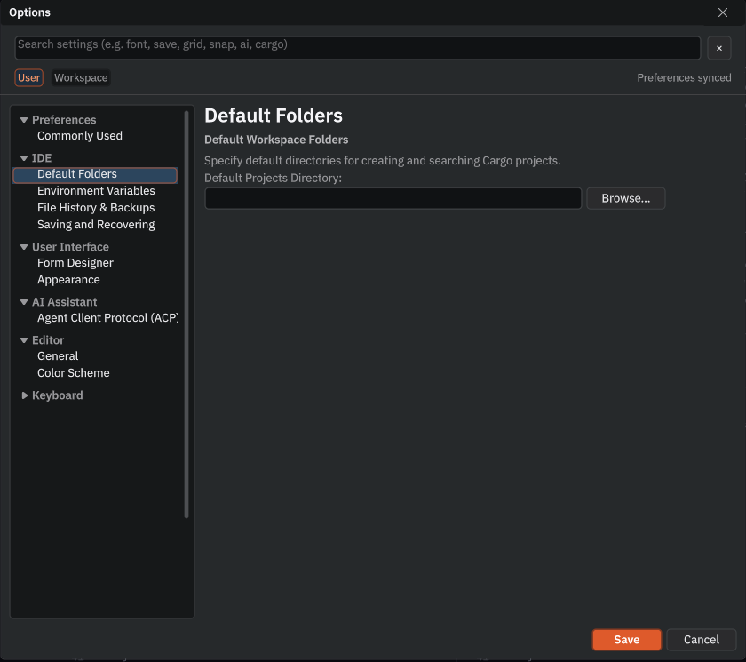

## IDE: Environment Variables

The Environment Variables page displays system environment variable inheritance policies.

1. In the left tree under **IDE**, click **Environment Variables**.
2. Inspect the inheritance note displayed on the page.

You see the heading `Environment Variables` and the notice: `System environment variables are inherited from the parent process.`

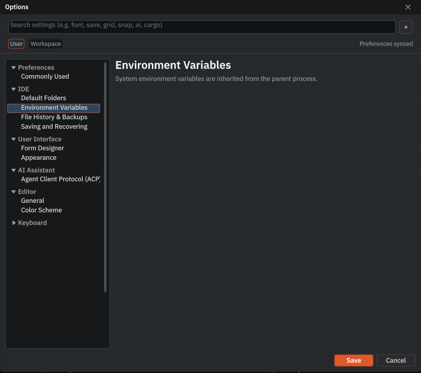

## IDE: File History & Backups

The File History & Backups page controls automated snapshot backups saved to `.crawrad/history` whenever files are saved.

1. In the left tree under **IDE**, click **File History & Backups**.
2. To enable or disable snapshot backups, toggle the **Keep a backup copy of a file on every save** checkbox (default: on).
3. To set maximum revisions per file, select an option from **File backup limit:** (`1`, `2`, `3`, `5`, `10`, `15`, `20`, `30`, `50`, or `100 copies`, default: `10 copies`).
4. To debounce frequent saves, select an interval from **Merge saves closer than:** (`Off`, `5 s`, `10 s`, `30 s`, or `60 s`, default: `10 s`).
5. To exclude large files from history, select an option from **Skip files larger than:** (`256 KB`, `1 MB`, `5 MB`, or `10 MB`, default: `5 MB` / `5120 KB`).

You see the heading `IDE / File History & Backups`, the description `A backup copy of the file is kept in .crawrad/history on every save.`, the master checkbox, and three parameter dropdown menus.

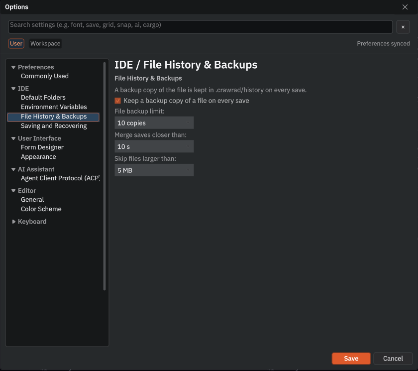

## IDE: Saving and Recovering

The Saving and Recovering page configures project reopening, pre-build saving, autorecovery intervals, and desktop layouts.

1. In the left tree under **IDE**, click **Saving and Recovering**.
2. Under **Autosave**, toggle **Reopen the last project on start** (default: on).
3. Highlight: Toggle **Save editor files before Build or Run** (default: off) to write every modified editor buffer to disk automatically before compiling or running.
4. Toggle **Save the project desktop on close** (default: on) to preserve docks, splitters, open editor tabs, and caret positions per project.
5. Select an automated saving strategy from **Auto save editor files:** (`Off`, `After delay (1 s)`, `On focus change`, or `On window change`, default: `Off`). Form design files are excluded from autosave because saving regenerates visual code.
6. Under **Autorecover**, toggle **Keep recovery copies of unsaved files** (default: on).
7. Select the autorecovery frequency from the **Every:** dropdown (`1 min`, `5 min`, `10 min`, or `30 min`, default: `10 min`). Copies are kept in `.crawrad/recover`.
8. Under **Desktop profiles**, view or change the **Active profile:** (`Default`), or click **Save as...** to store the current window arrangement, **Remove** to delete a profile, or **Restore default** to reset layout.

You see three grouped sections (**Autosave**, **Autorecover**, **Desktop profiles**) with checkboxes, interval dropdowns, explanatory labels, and profile management buttons.

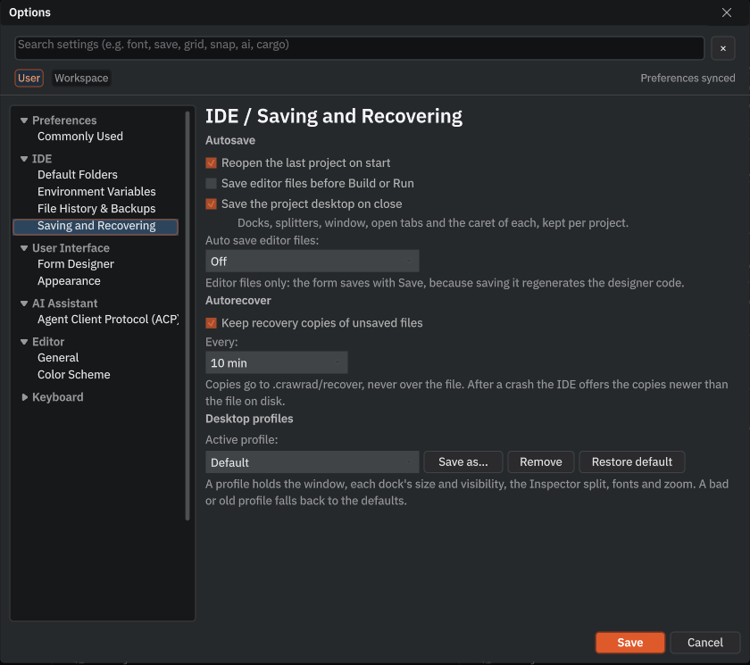

## User Interface: Form Designer

The Form Designer page controls visual grid display, snapping alignment, and spacing tolerances.

1. In the left tree under **User Interface**, click **Form Designer**.
2. Highlight: Under **Grid options**, toggle **Display grid** (default: on) to show or hide the dot grid pattern on the canvas.
3. Highlight: Toggle **Snap to grid** (default: on) to snap components to grid multiples during moving and resizing.
4. Highlight: In **Grid size / snap tolerance**, type a pixel size into the text input, or click the **-** and **+** buttons to adjust cell dimensions (range: 2 to 64 pixels, default: `8` pixels).
5. Review the precision notice: `Minimum: 2 (high precision).`.

You see the heading `Form Designer`, two columns for **Grid options** and **Grid size / snap tolerance**, the numeric field with `-` and `+` buttons, and the precision footnote.

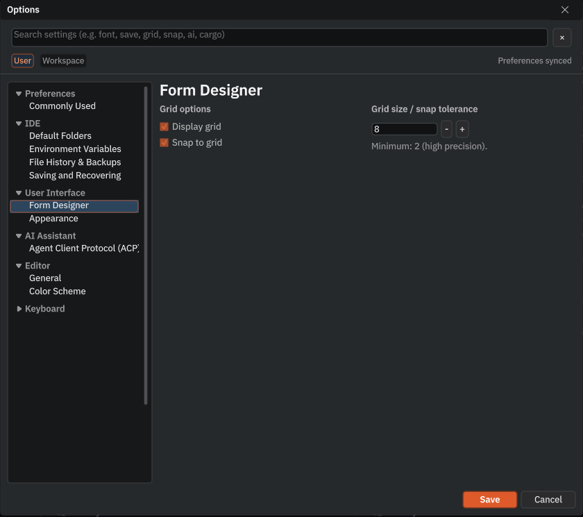

## User Interface: Appearance

The Appearance page describes UI zoom behavior, IDE themes, and palette icon assets.

1. In the left tree under **User Interface**, click **Appearance**.
2. Highlight: Under **Zoom**, review the note explaining that window-wide scaling in this shell is driven dynamically via keyboard shortcuts:
   - Press <kbd>Ctrl</kbd>+<kbd>=</kbd> (<kbd>Ctrl</kbd>+<kbd>=</kbd>) or select **View > Zoom > Zoom in (interface)** to enlarge the whole IDE interface.
   - Press <kbd>Ctrl</kbd>+<kbd>-</kbd> (<kbd>Ctrl</kbd>+<kbd>-</kbd>) or select **View > Zoom > Zoom out (interface)** to shrink the whole IDE interface.
   - Press <kbd>Ctrl</kbd>+<kbd>0</kbd> (<kbd>Ctrl</kbd>+<kbd>0</kbd>) or select **View > Zoom > Zoom 100% (interface)** to reset interface scale to 100%.
3. Under **Theme**, review the platform styling note: `One theme for now. The form you draw keeps the colours of the target platform, whatever the IDE wears.`
4. Click **Icon sheet...** to open the palette icon preview sheet.

You see the heading `Appearance`, the two grouped sections for **Zoom** and **Theme** with their descriptions, and the `Icon sheet...` button.

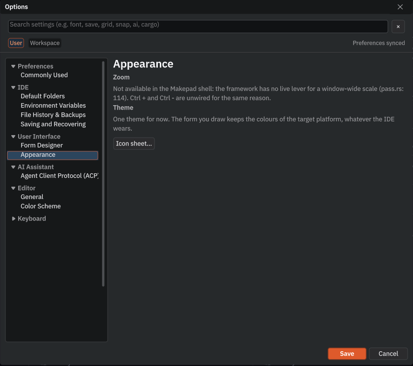

## AI Assistant: Agent Client Protocol (ACP)

The Agent Client Protocol (ACP) page configures the active AI assistant agent, models, reasoning effort, and permission policies.

1. In the left tree under **AI Assistant**, click **Agent Client Protocol (ACP)**.
2. Highlight: Under **Agent in use**, inspect the active agent card displaying the agent name, version, status dot (`Ready` 🟢, `Signed out` 🟡, or `Not installed` 🔴), status description, and action button (such as `Install` or `Sign in`).
3. Click **Change agent…** to browse the ACP Registry catalog:
   - Search available agents using the `Search agents` input field.
   - Click **Select** on an installed agent to activate it, or **Install** to download an agent binary.
   - Click **‹ AI Assistant** to return to the main ACP configuration view.
4. Click **Show advanced** to inspect the agent command line, click **Test connection** to verify connectivity, or click **Open terminal** to start a terminal session.
5. Under **Defaults for new chats**, pick the default **Model** (for example **Auto**). The list is the one the agent offers, the same as the chat buttons.
6. Pick the default **Effort** (for example **High**), when the agent supports it.
7. Under **Permissions**, configure automation boundaries:
   - **Approve read operations without asking** (on by default): the agent reads files without stopping to ask.
   - **Let the agent use its own tools** (off by default): the agent may use tools of its own besides the IDE's.

You see the heading `AI Assistant / Agent Client Protocol (ACP)`, the bordered **Agent in use** card with status indicators, Model and Effort dropdowns, permission checkboxes, and the ACP Registry card list when changing agents.

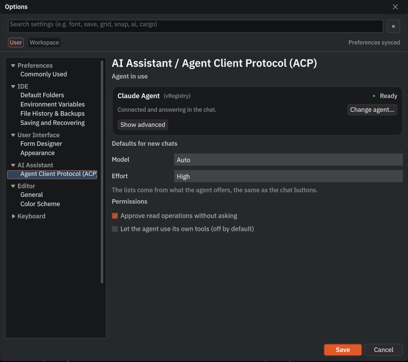

## Editor: General

The General editor page controls font size, tab stop width, line numbering, inlay hints, and breadcrumb styling.

1. In the left tree under **Editor**, click **General**.
2. Select the font scale from **Editor Font Size:** (`9 pt`, `10 pt`, `11 pt`, `12 pt`, `14 pt`, `16 pt`, `18 pt`, or `20 pt`, default: `11 pt`).
3. Select indentation width from **Tab Indentation Size:** (`2 spaces`, `4 spaces`, or `8 spaces`, default: `4 spaces`).
4. Toggle **Show line numbers in editor margin** (default: on).
5. Toggle **Show inferred types in grey inside the lines (inlay hints)** (default: on).
6. Toggle **Highlight the line the caret is on** (default: on).
7. Toggle **Breadcrumb in Chevron style (off: plain text)** (default: on).

You see the heading `Editor`, the subtitle `Configure typography, indentation, and margins for the code editor.`, two dropdowns, and four option checkboxes.

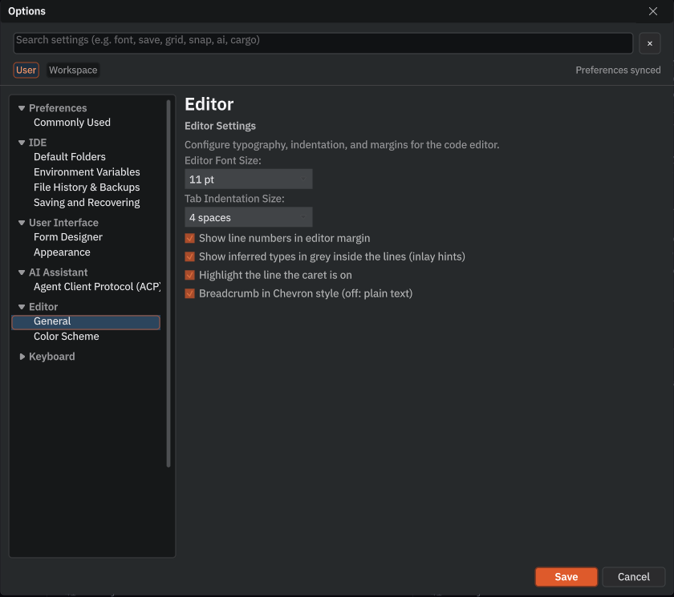

## Editor: Color Scheme

The Color Scheme page customizes syntax token palettes, error/warning highlight bands, and diagnostics styling.

1. In the left tree under **Editor**, click **Color Scheme**.
2. Choose a preset from **Color Theme Preset:** (default: **Modern Dark**; the others are **Classic Dark** and **Vivid Dark**).
3. Click **Reset Default** to revert any customized token colors back to the built-in theme defaults.
4. To change a token colour (Keywords, Types, Functions, Identifiers, Numbers, Strings, Comments, Delimiters, Background), type a `#RRGGBB` value or click **...** next to it to pick one. The preset changes to **Custom**.
5. Customize compiler diagnostic text and line highlight band colors under **Diagnostics (message and line number · line band)**:
   - **Error:** and **Error band:**
   - **Warning:** and **Warning band:**
   - **Info:** and **Info band:**
6. Review your custom palette rendered in real time in the **Sample** preview code box.

You see two columns of color inputs with color swatch buttons, hex inputs, and picker buttons, diagnostic styling controls, and the live syntax sample box.

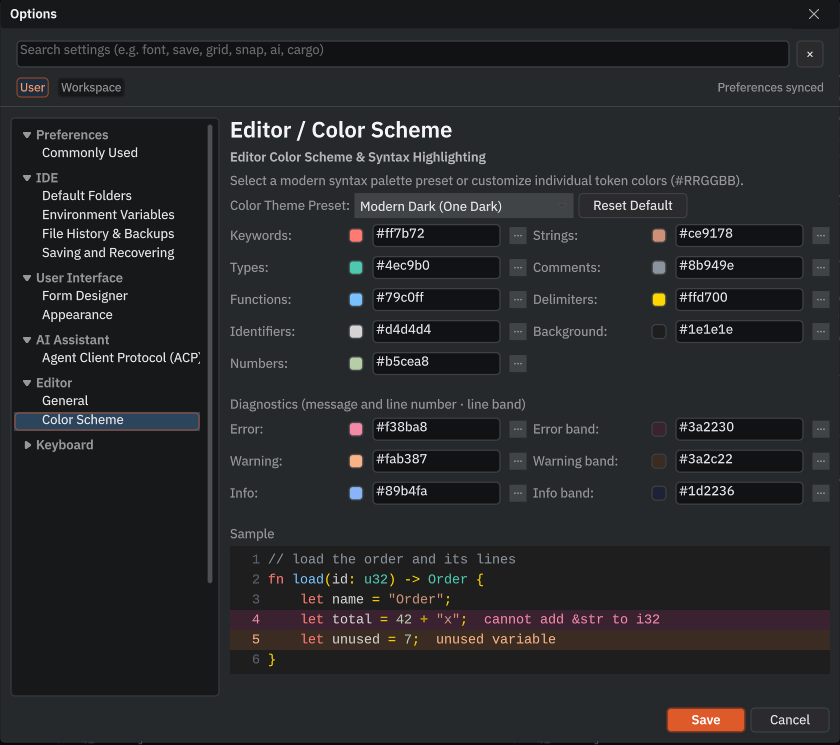

## Keyboard: Key Mappings

The Key Mappings page sets the active IDE keyboard shortcut preset between Modern and Classic schemes.

1. In the left tree under **Keyboard**, click **Key Mappings**.
2. Highlight: In **Keymap Scheme Preset:**, select your preferred scheme:
   - **Modern (Default)**: the shortcuts most editors use today.
   - **Classic**: the shortcuts of the classic RAD IDEs.
3. Read the summary description beneath the dropdown showing the primary keybindings for the selected preset.
4. Scroll through the keybindings list displaying each command name on the left and its corresponding shortcut on the right.

You see the heading `Keyboard Shortcuts & Keymap Scheme`, the scheme selection dropdown, summary note, and a scrollable table of all actions and their active key bindings.

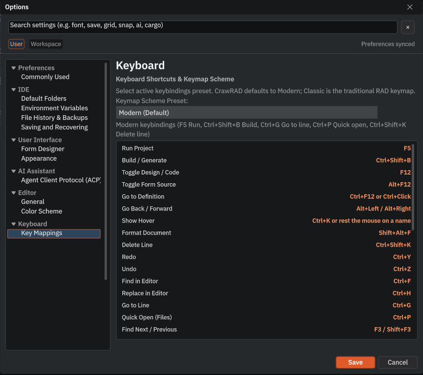

## Save or cancel options changes

The footer buttons apply your configuration changes to disk or discard all modifications made during the dialog session.

1. Click **Save** to write updated preferences to disk and apply them immediately across the IDE.
2. Click **Cancel** or press <kbd>Esc</kbd> to discard all changes and revert settings to their previous values.

You see the dialog close and the IDE apply updated font sizes, color themes, grid dimensions, and keybinding schemes immediately without restart.

<!-- SOURCES: crates/crawrad-project/src/options.rs:18-494, crates/crawrad-project/src/workspace.rs:1000-1144, crates/crawrad-actions/src/lib.rs:1702-1810, crates/crawrad-actions/src/lib.rs:3725-3739, crates/crawrad-actions/src/lib.rs:3910-3977, crates/crawrad-actions/src/key_routing.rs:54-72, crates/crawrad-ide/src/ide_app/dialogs/dsl/options_dialog.rs:20-690, crates/crawrad-ide/src/ide_app/dialogs/options.rs:51-414 -->
