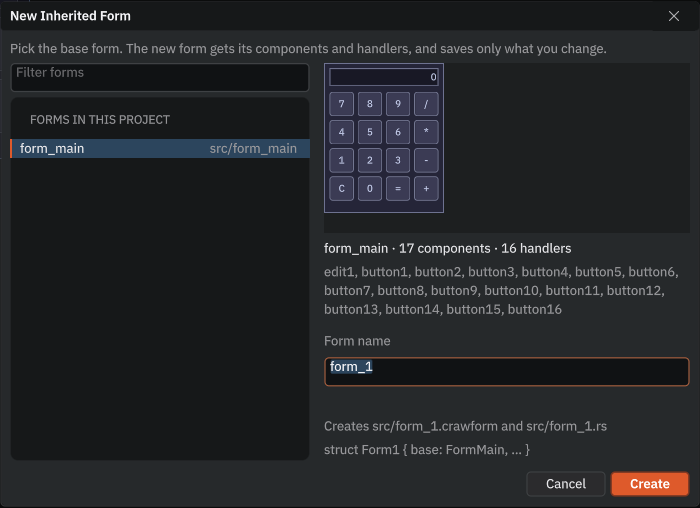
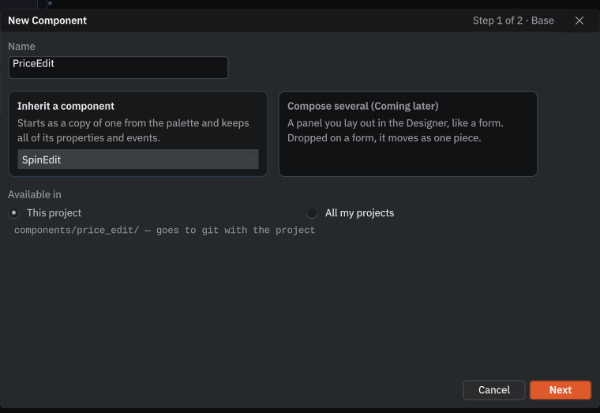
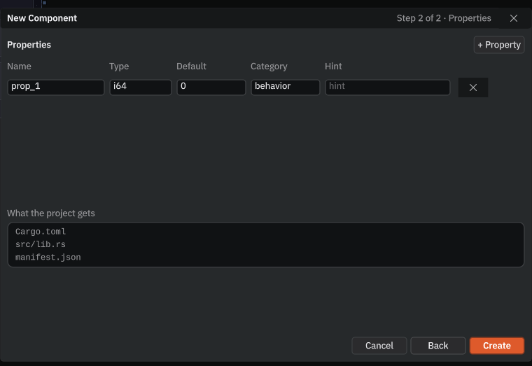

# Reuse a form and make your own components

CrawRAD lets you inherit existing forms to build specialized views, and create custom reusable components that appear directly in the designer palette.

## Create a new inherited form

Inherited forms share all components, layout, and event handlers from a base form while storing only your specific additions and property overrides.

1. Open the project containing the form you want to inherit.
2. Select **File > New Inherited Form...**.
3. In the **New Inherited Form** dialog:
   - Use the **Filter forms** box to find your base form in the tree on the left.
   - Inspect the live preview and component summary on the right.
   - In the **Form name** field, type a unique name in `snake_case` (for example, `customer_dialog`).
4. Click **Create**.

CrawRAD creates `customer_dialog.crawform` and its accompanying code file `customer_dialog.rs`.

### How inherited forms work

- **Delta persistence**: The inherited `.crawform` saves only changes relative to the base form. If you update the base form later, those updates automatically propagate to all inherited forms.
- **Inspect base elements**: Inherited components appear on the canvas and in the **Object Inspector**.
- **Navigate to base**: To open the parent form in the designer, choose **Go to base form** from the **Go** menu.
- **Event handlers**:
  - In the **Object Inspector** > **Events** tab, select **Override inherited event** to write a handler in the child form that automatically calls the base handler first.
  - To revert an event back to the base form's implementation, select **Revert to inherited**.

## Create a new component

The New Component wizard scaffolds a self-contained component package with property definitions, ready to drop onto any form.

1. Select **File > New Component...**.
2. **Step 1 of 2 · Base**:
   - In **Name**, type a `PascalCase` name for your component (for example, `PriceEdit`).
   - Under **Inherit a component**, select the native base class from the drop-down (for example, `SpinEdit` or `Edit`).
   - Under **Available in**, pick the scope:
     - **This project**: Installed into `<project>/components/<name>` and available only in the active project.
     - **All my projects**: Installed into the global configuration folder and available in every workspace.
   - Click **Next**.
3. **Step 2 of 2 · Properties**:
   - Click **+ Property** to add custom properties.
   - For each property, specify:
     - **Name**: A `snake_case` identifier (for example, `currency_code`).
     - **Type**: `String`, `i64`, `f64`, or `bool`.
     - **Default**: The initial default value (for example, `USD` or `0.0`).
     - **Category**: Property inspector category (defaults to `behavior`).
     - **Hint**: A description displayed in hover tooltips.
   - Click **Create**.

CrawRAD writes the component crate files:
- `Cargo.toml`: Declares dependencies on `crawrad-component` and `crawrad-component-derive`.
- `src/lib.rs`: Defines your component struct with `#[derive(Component)]` and `#[crawrad(inherits = "...")]`.
- `manifest.json`: Component metadata and property descriptor.

The IDE catalog automatically reloads, and your new component appears under the **My components** category in the palette.

## Install an external component package

To install a third-party component package:

1. Select **Component > Install Package...**.
2. Select the folder containing the component's `manifest.json`.
3. CrawRAD checks the manifest. Once accepted, the package is copied into the components directory and registered in the palette.
4. To inspect active or refused packages, select **Component > Installed Packages...**.

<!-- SOURCES: crates/crawrad-ide/src/ide_app/dialogs/inherit_form.rs:1-135, crates/crawrad-ide/src/ide_app/dialogs/new_component.rs:1-168, crates/crawrad-project/src/inherited_form.rs:1-200, crates/crawrad-project/src/new_component.rs:1-290, crates/crawrad-project/src/installation.rs:1-120, crates/crawrad-package/src/manifest.rs:1-60 -->
