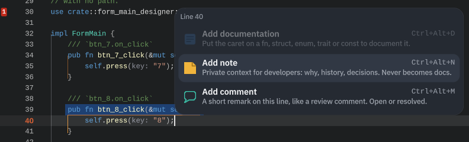
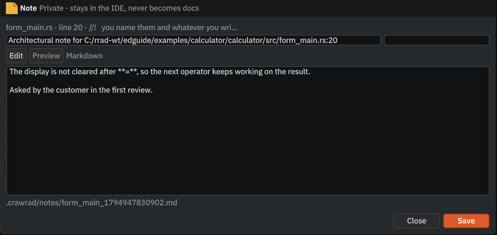
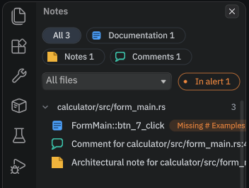

# Add notes and documentation to your code

CrawRAD provides a sidecar note system that attaches public documentation, private developer context, or review comments to your code without cluttering your source files.

Full note content is stored in Markdown files under `.crawrad/notes/` in the project root, while your source code keeps only a compact anchor or attribute.

## The three kinds of notes

CrawRAD supports three note kinds:

1. **Documentation** (<kbd>Ctrl</kbd>+<kbd>Alt</kbd>+<kbd>D</kbd>):
   - Public documentation in standard rustdoc format. Shows in `cargo doc` and docs.rs.
   - Attach it by placing the caret on a `fn`, `struct`, `enum`, `trait`, or `const`.
   - Adds a `#[note("<id>")]` attribute above the item. During build, the `crawrad-note` macro transforms the note into rustdoc attributes (`#[doc = "..."]`).
   - Warns if the function or struct signature changes after the documentation was written.
2. **Internal Note** (<kbd>Ctrl</kbd>+<kbd>Alt</kbd>+<kbd>N</kbd>):
   - Private context for developers: reasons, history, and architectural decisions. Never exported to public docs.
   - Adds an anchor comment in your source file: `// [crawrad:note#<id>]`.
3. **Comment** (<kbd>Ctrl</kbd>+<kbd>Alt</kbd>+<kbd>M</kbd>):
   - A short review remark on a line.
   - Adds an anchor comment: `// [crawrad:comment#<id>]`.
   - Can be marked as **Resolved** or reopened.

## Add a note at the caret

1. In the code editor, place the caret on the line or item you want to annotate.
2. Press <kbd>Ctrl</kbd>+<kbd>Shift</kbd>+<kbd>N</kbd> (or select **Tools > Notes...**).
3. Choose **Add documentation**, **Add note**, or **Add comment** from the popup menu (or use their direct shortcuts: <kbd>Ctrl</kbd>+<kbd>Alt</kbd>+<kbd>D</kbd>, <kbd>Ctrl</kbd>+<kbd>Alt</kbd>+<kbd>N</kbd>, or <kbd>Ctrl</kbd>+<kbd>Alt</kbd>+<kbd>M</kbd>).
4. In the dialog, type your Markdown content.
5. Click **Save**.

## Write documentation notes

When editing a documentation note, a row of buttons inserts the usual rustdoc
sections: **Summary**, **# Examples**, **# Errors**, **# Panics** and
**# Safety**, plus **Link item…** to link another item. Beside them, CrawRAD
suggests the sections the item's signature asks for (for example **# Errors**
for a function that returns a `Result`).

To test your example code without compiling the whole application, click **Test example**. CrawRAD runs the doctest in the background and reports pass or fail in the dialog.

Use **Preview** to check your formatted Markdown before saving.

## Work with line comments

1. Place the caret on a code line and press <kbd>Ctrl</kbd>+<kbd>Alt</kbd>+<kbd>M</kbd>.
   If another program on your computer already uses that shortcut, press
   <kbd>Ctrl</kbd>+<kbd>Shift</kbd>+<kbd>N</kbd> and choose **Add comment**.
2. Type your review comment and click **Save**.
3. When the issue is addressed, reopen the note dialog and click **Resolve**. Resolved comments are hidden from the gutter mark list while remaining searchable in the **Notes** panel.
4. To reactivate a resolved comment, open it and click **Reopen**.

## View all notes in the Notes panel

To inspect every note and comment in the open workspace:

1. Open the **Notes** panel from **View › Panels › Notes**.
2. Filter by kind with the chips at the top, each with its count: **All**,
   **Documentation**, **Notes** and **Comments**. A second filter picks the file,
   or **All files**.
3. Click any note entry in the list to open the corresponding file and navigate directly to the line.

A note that needs attention carries a badge, such as **Missing # Examples** on a
documentation note without an example. **In alert** lists only those.

<!-- SOURCES: crates/crawrad-ide/src/ide_app/dialogs/notes.rs:1-120, crates/crawrad-project/src/note_dialog.rs:1-350, crates/crawrad-project/src/sidecar_notes.rs:1-240, crates/crawrad-project/src/notes_panel.rs:1-120, crates/crawrad-note/src/lib.rs:1-32, crates/crawrad-note-format/src/lib.rs:1-90 -->
