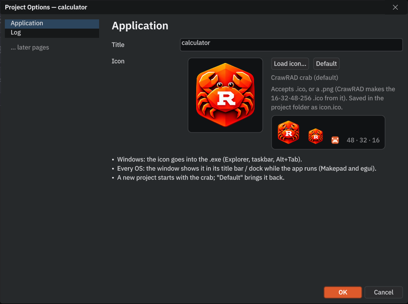
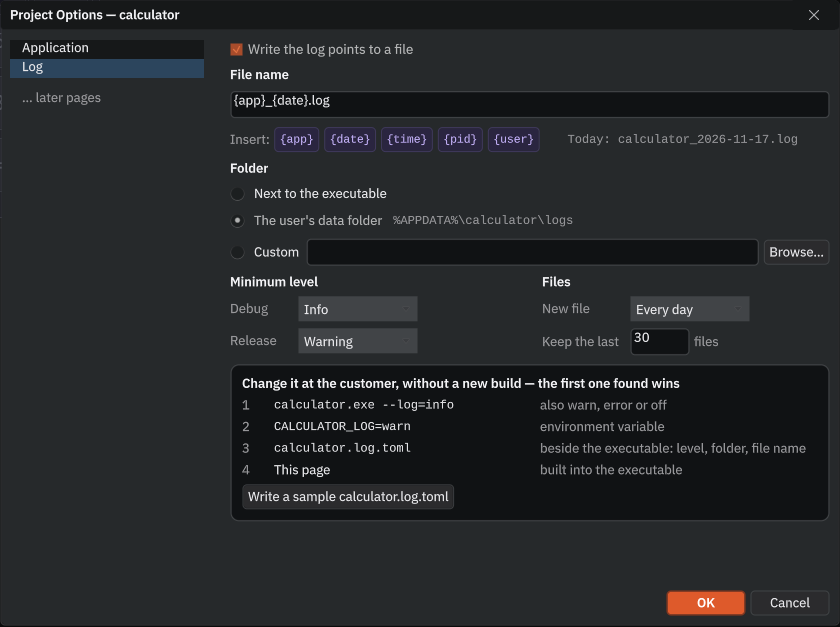

# Set project options and the app icon

In CrawRAD, you can set the application window title, configure application icons across all target resolutions, and set up file-based logging directly from the **Project Options** dialog.

To open the dialog, select **Project > Options...** from the main menu.

The left navigation pane provides two configuration pages: **Application** and **Log**.



## Application options and icon

On the **Application** page:

### Title
- In the **Title** field, type the window and taskbar title for your application.
- If left blank, the title defaults to the `[package] name` defined in `Cargo.toml`.

### Application icon
CrawRAD displays previews of your icon in four resolutions: 256×256, 48×48, 32×32, and 16×16.

1. To load a custom icon, click **Load icon…**.
2. Select either:
   - An `.ico` file containing icon frames.
   - A `.png` image. CrawRAD automatically generates the multi-resolution `.ico` (with 16, 32, 48, and 256 pixel frames) and saves it as `icon.ico` in your project folder.
3. To revert back to the default CrawRAD crab icon, click **Default**.
4. Click **OK** to save your changes.

### Platform icon behavior
- **Windows**: The icon is embedded directly into the compiled `.exe` resource table, showing in File Explorer, on the taskbar, and in the Alt+Tab task switcher.
- **Every operating system**: The icon is displayed in the window title bar and dock while the application runs.

### What CrawRAD writes
CrawRAD stores these options under `[package.metadata.crawrad]` in your project's `Cargo.toml`:

```toml
[package.metadata.crawrad]
title = "Inventory Manager"
icon = "custom"
```

The user comments, formatting, and other sections in your `Cargo.toml` remain untouched.

## Configure application logging

Open the **Log** page to configure file logging for your application.



1. Check **Write the log points to a file** to enable logging.
2. In the **File name** field, type the log file pattern. You can click the marker chips to insert dynamic tokens:
   - `{app}`: Application package name.
   - `{date}`: Current date (`YYYY-MM-DD`).
   - `{time}`: Timestamp (`HHMMSS`).
   - `{pid}`: Operating system process ID.
   - `{user}`: Current user name.
3. Under **Folder**, choose where log files are stored:
   - **Next to the executable**: Writes logs into the directory containing your compiled binary.
   - **The user's data folder**: Stores logs in the user configuration directory (e.g., `%APPDATA%\<app>\logs` on Windows).
   - **Custom**: Type a directory path or click **Browse…** to select one.
4. Set the **Minimum level** for **Debug** builds and **Release** builds:
   - Choose from `Debug`, `Info`, `Warning`, `Error`, or `Off`.
5. Under **Files**, configure log rotation:
   - **New file**: every day, or every run. A new file every day needs `{date}` in the name; a new file every run needs `{time}` or `{pid}`.
   - **Keep the last**: Set the maximum number of log files to retain before older logs are purged.
6. Click **OK** to save your settings.

### Runtime override precedence
Log options can be adjusted in deployed applications without rebuilding. CrawRAD applies settings in the following order (first found wins):

1. Command line flags passed at launch.
2. Environment variables set on the machine.
3. An override configuration file placed beside the executable.
4. The defaults configured in this dialog and compiled into the executable.

<!-- SOURCES: crates/crawrad-ide/src/ide_app/dialogs/project_options.rs:1-120, crates/crawrad-ide/src/ide_app/dialogs/dsl/project_dialogs.rs:818-872, crates/crawrad-project/src/project_options.rs:1-110, crates/crawrad-actions/src/project_options_dialog.rs:1-150, crates/crawrad-actions/src/project_log.rs:1-100 -->
