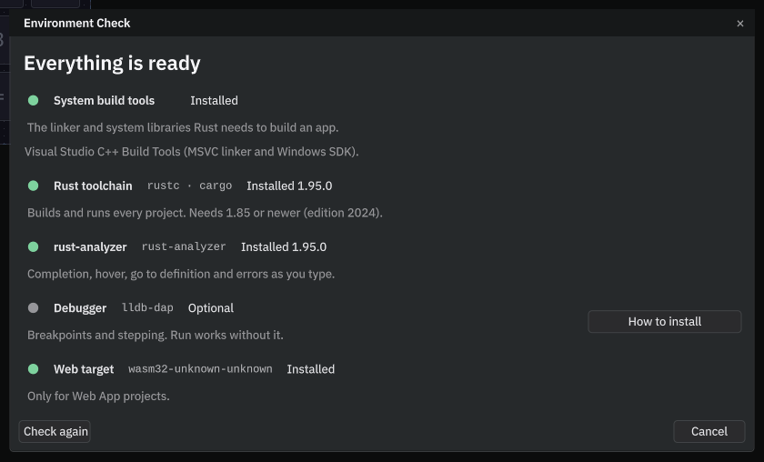

# Install CrawRAD

CrawRAD is a visual RAD IDE for Rust. It builds native desktop, web, and console applications using the standard Rust toolchain.

## What you need

Before building and running applications in CrawRAD, ensure your system has:

1. **Rust toolchain**: `rustc` and `cargo` version 1.85.0 or newer (supporting Rust edition 2024).
2. **System build tools**:
   - **Windows**: the C++ build tools (MSVC linker and Windows SDK).
   - **macOS**: Command line developer tools.
   - **Linux**: A C compiler (`cc`), `pkg-config`, and development libraries for X11, Wayland, and ALSA (`libx11-dev`, `libxcursor-dev`, `libxkbcommon-dev`, `libasound2-dev`).

If any of these tools are missing when you first launch CrawRAD, the built-in **Environment Check** helps you set them up.

## Installing CrawRAD

### Windows

CrawRAD is distributed for 64-bit Windows as an installer and as a portable archive:

- **Setup installer** (`CrawRAD-<version>-windows-x64-setup.exe`):
  1. Run the setup executable.
  2. Choose the destination folder (defaults to `Program Files\CrawRAD` or a per-user directory).
  3. Optionally select the **Create a desktop shortcut** task.
  4. Complete the wizard. The installer creates a **CrawRAD** Start menu group and shortcuts to launch CrawRAD and its uninstaller.
- **Portable archive** (`CrawRAD-<version>-windows-x64.zip`):
  1. Extract the `.zip` archive to any directory.
  2. Launch `crawrad-ide.exe`.

### Linux and macOS

The Beta downloads are for Windows. Packages for Linux (AppImage and `.tar.gz`)
and macOS (`.dmg`) are already prepared in the source tree and will be
published in a following release.

## First start and the Environment Check

On its first start, CrawRAD inspects your system. If any required development tool is missing or outdated, the **Environment Check** dialog opens automatically. You can also open this dialog at any time from **Help > Check Environment...**.

The dialog inspects five tools:

| Tool | Status | Purpose |
|---|---|---|
| **System build tools** | Required | The linker and system libraries Rust needs to build an app. |
| **Rust toolchain** (`rustc · cargo`) | Required | Builds and runs every project. Needs 1.85 or newer (edition 2024). |
| **rust-analyzer** | Required | Completion, hover, go to definition and errors as you type. |
| **Debugger** (`lldb-dap`) | Optional | Breakpoints and stepping. Run works without it. |
| **Web target** (`wasm32-unknown-unknown`) | Optional | Only for Web App projects. |

### Installing missing tools

When tools are missing, the dialog provides action buttons:

1. **Install all missing (N)**: Runs the automated installation pipeline in the background for all tools that can be installed automatically.
2. Individual tool buttons:
   - **Download and install**: Downloads `rustup-init` and installs the Rust toolchain.
   - **Install**: Uses `rustup` to update the compiler (`rustup update stable`), add `rust-analyzer` (`rustup component add rust-analyzer`), or add the WebAssembly target (`rustup target add wasm32-unknown-unknown`).
   - **Open download page**: Opens the download page in your browser for system build tools on Windows.
   - **Copy command**: Copies the package manager install command to the clipboard on Linux.
   - **How to install**: Displays instructions to install `lldb-dap` for your operating system.
3. **Check again**: Re-probes the machine and refreshes every status indicator.
4. **Stop install**: Cancels an in-progress background installation.
5. **Cancel**: Closes the dialog. You can continue designing forms even before all build tools are installed.

## Where CrawRAD keeps settings

CrawRAD stores its global configuration, desktop profiles, recent projects list, and assistant history in your user configuration folder:

- **Windows**: `%APPDATA%\CrawRAD\` (for example, `C:\Users\<username>\AppData\Roaming\CrawRAD\`)
- **Linux and macOS**: `$XDG_CONFIG_HOME/crawrad/` or `~/.config/crawrad/`

Project-specific notes and options are stored directly inside the opened workspace under `.crawrad/` and `Cargo.toml`.

## How to uninstall

- **Windows**: Run **Uninstall CrawRAD** from the Start menu, or open Windows Settings > **Installed apps** and uninstall CrawRAD. For portable `.zip` installations, delete the extracted folder.

To remove all configuration files, delete the CrawRAD settings folder in `%APPDATA%\CrawRAD` (Windows) or `~/.config/crawrad` (Linux and macOS).

<!-- SOURCES: installer/windows/crawrad.iss:1-45, installer/linux/package.sh:1-43, installer/macos/package.sh:1-32, tools/bundle/bundle.py:1-140, .github/workflows/release.yml:1-94, crates/crawrad-ide/src/ide_app/dialogs/environment.rs:1-101, crates/makepad-code-editor/src/environment_view.rs:1-250, crates/crawrad-project/src/environment.rs:1-380, crates/crawrad-project/src/environment_session.rs:1-250, crates/crawrad-project/src/workspace.rs:236-260 -->
