# A form that edits a database

> **About 15 minutes** · Windows, Linux, macOS · No Rust experience needed

**You will build** a window that lists the contacts of a small SQLite
database and lets you change them: pick a row, edit it in three boxes, and
save it, add a new contact, or delete one. Once again you will not write a
line of code. Along the way you will:

- open a whole table with a Dataset, instead of a query;
- bind an Edit to one field of the Dataset;
- add actions that insert, save, delete and cancel;
- give each button an action;
- run the app and check that the changes reach the database file.

This tutorial continues [A form that reads a database](a-form-that-reads-a-database.md).
If you have not done that one yet, do it first: the first steps are the same.

## 1. Create the project and the chain

Create a **GUI Application** named `contacts_edit` and copy `contacts.db` into
its inner `contacts_edit` folder, as in steps 1 and 2 of the previous tutorial.
Then place **SQLite Provider (rusqlite)**, **Connection** and **Dataset**, and
link them the same way: `conn1` gets Provider `sqlite1` and Url
`sqlite:contacts.db`, and `dst1` gets Connection `conn1`.

## 2. Open the whole table

This time, leave the Dataset's **SQL** empty. Instead, with `dst1` selected,
set **Table** (under **Behavior**) to `contacts` and press <kbd>Enter</kbd>.

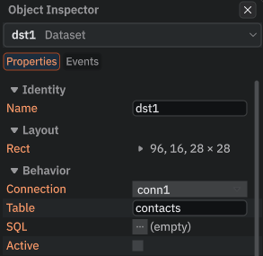

A Dataset with a table and no SQL is in **table mode**: it reads every row of
the table, and it knows which table to write back to. A Dataset with an SQL
query can only read.

## 3. Add the Grid

In the **Toolbox**, under **Additional**, click **Grid** and place it below the
icons, across the top half of the form. In its **Data** category, set
**DataSource** to `dst1`. The Grid stays empty in the Designer; the rows
and the four columns of the table, `id` included, appear when the app runs.

## 4. Add three Edits bound to fields

Under **Standard**, place a **Label** and an **Edit** side by side below the
Grid, three times. Set the Labels' **Caption** (under **Appearance**) to
`Name`, `Email` and `City`.

Select the first Edit. Its **Data** category, right below **Appearance**, has
three rows:

- **Dataset**: pick `dst1`;
- **Field**: pick `name` (once the Dataset is set, the list shows the table's
  columns: `id`, `name`, `email`, `city`);
- **Mode**: leave `TwoWay`. The Edit shows the field, and what you type goes
  back to it.

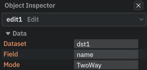

Do the same for the other two Edits, with the fields `email` and `city`.

Finally, link each Label to its Edit: select the Label and, under
**Behavior**, set **FocusControl** to the Edit beside it. Without it, the
**Form check** in the title bar warns that the Label labels an Edit but its
FocusControl is empty.

## 5. Add the actions

Under **Standard**, place an **ActionList** next to the other icons. With it
selected, choose **Edit › New action** four times. The IDE adds `action1` to
`action4` and selects each new one as it goes. Select each action in turn
(the drop-down at the top of the Object Inspector lists them) and set its
**Caption** under **Appearance**, then its **Dataset** and **Dataset
Operation** under **Behavior**:

| Action | Caption | Dataset | Dataset Operation |
|---|---|---|---|
| `action1` | `Insert` | `dst1` | `Insert` |
| `action2` | `Save` | `dst1` | `Post` |
| `action3` | `Delete` | `dst1` | `Delete` |
| `action4` | `Cancel` | `dst1` | `Cancel` |

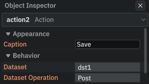

**Post** is the name of the operation that writes the row you are editing to
the database. The action does the work, and it also knows when it makes
sense: **Save** and **Cancel** are only enabled while you are editing a row,
**Insert** and **Delete** only while you are not.

## 6. Give each button an action

Place four **Buttons** in a row at the bottom of the form. Select the first
one and, under **Behavior**, set **Action** to `action1`, the Insert action.
On the form, the button now shows the action's caption. Do the same for the
other three buttons with `action2` (Save), `action3` (Delete) and `action4`
(Cancel).

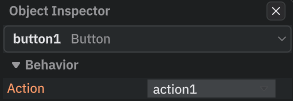

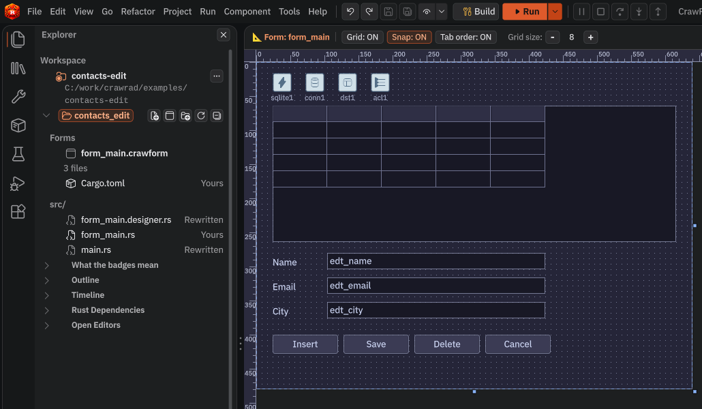

## 7. Run it and edit

Save with <kbd>Ctrl</kbd>+<kbd>S</kbd> and press <kbd>F5</kbd>
(<kbd>F9</kbd> in the Classic keymap).

Click the row of **Chloe Martin**. The three Edits show her record.

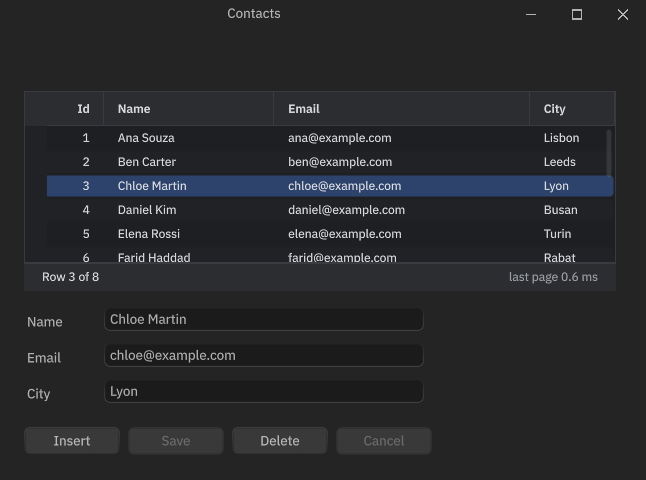

Click in **City**, replace `Lyon` with `Marseille`. As soon as you type, the
row is being edited: **Save** and **Cancel** light up, **Insert** and
**Delete** go grey.

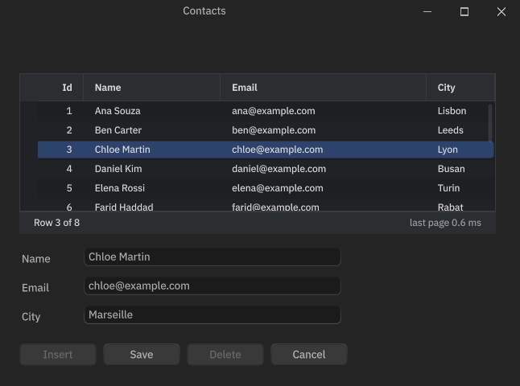

Click **Save**. The Grid reloads from the database and shows `Marseille`.

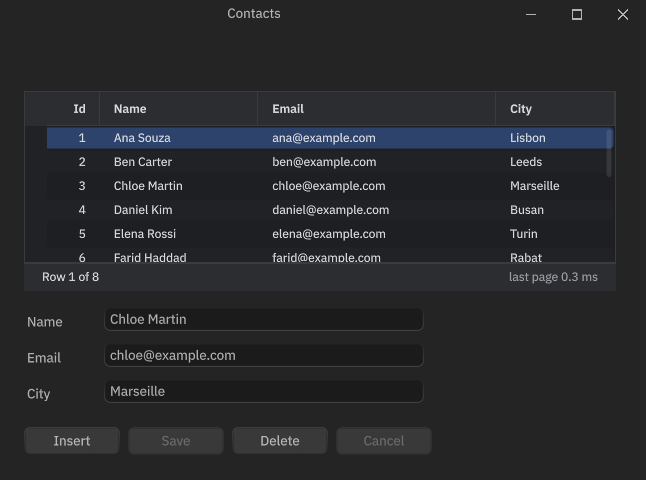

> **Checkpoint.** Close the app and open it again: Chloe Martin still lives in
> Marseille. The change is in `contacts.db`, not only on screen.

If you change a field and click **Cancel** instead, the Edits go back to the
saved values and nothing is written.

## 8. Add and delete a contact

Click **Insert**. The Edits are now a new, empty row. Type a name, an email
and a city, then click **Save**.

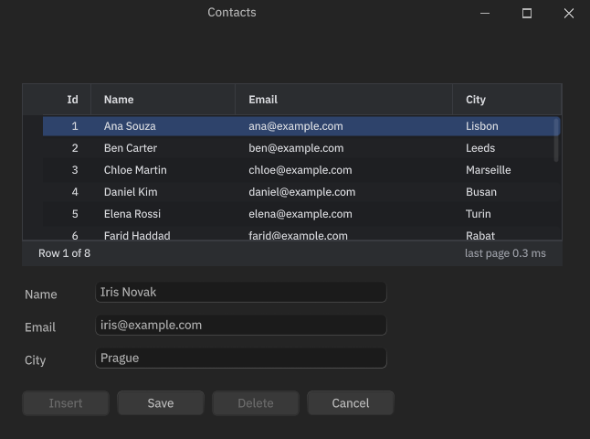

The Grid now has nine rows. The database gives the new contact its `id`.

To delete it, make it the current row (after the save it already is; otherwise
click its row in the Grid, so the Edits show it) and click **Delete**.

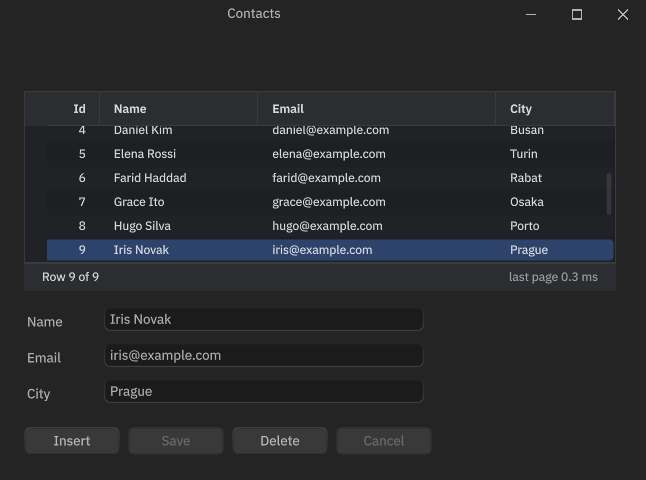

The row is gone from the database, and the Grid is back to eight rows.

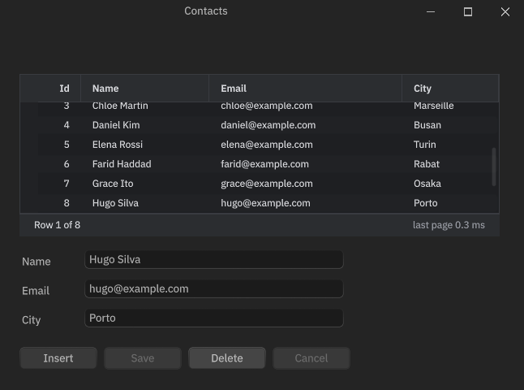

> **Tip.** After a save the Grid reloads and keeps the row you saved as the
> current one. After a delete, a neighbouring row becomes current and the
> Edits show it. Always check which record the Edits show before you press
> **Delete**.

## What you learned

- A Dataset with a **Table** and no SQL can write: the Grid moves its current
  row, and the bound Edits show and change that row.
- An Edit's **Data** category binds its text to one field of a Dataset.
- An action with a **Dataset Operation** inserts, saves (Post), deletes or
  cancels, and enables itself only when that makes sense. A button just points
  at it.

The finished project is in `examples/contacts-edit` in the CrawRAD repository.

**Next:** [Publishing your app for the web](publishing-your-app-for-the-web.md).
