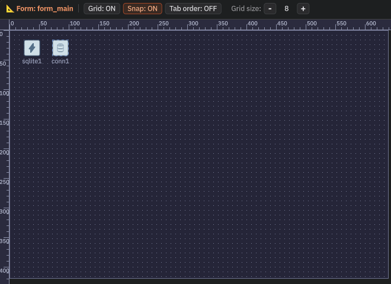
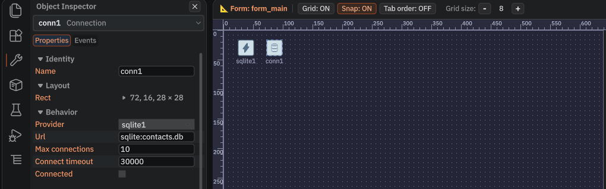
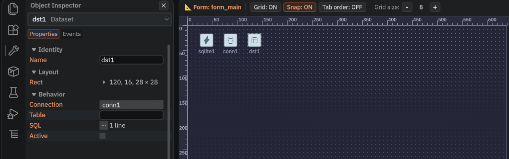
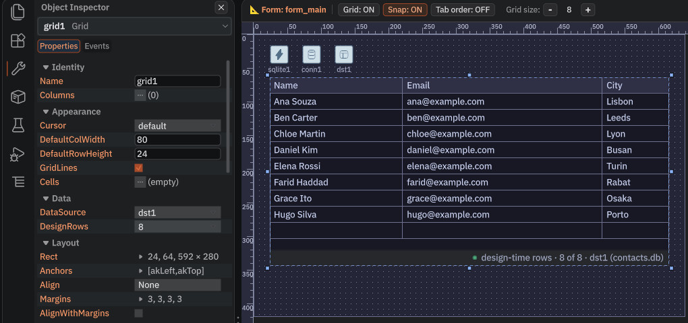
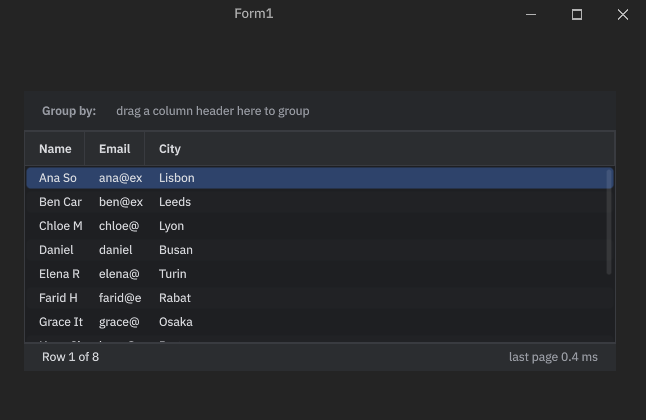

# A form that reads a database

> **About 10 minutes** · Windows, Linux, macOS · No Rust experience needed

**You will build** a window that lists the contacts stored in a small SQLite
database. You will not write a single line of code. Along the way you will:

- place non-visual components on a form;
- point one component at another in the Object Inspector;
- ask the database for rows with an SQL query;
- see real rows from the database while you design;
- run the app and see the same rows live.

## 1. Create the project

Create a **GUI Application** named `contacts`, the same way you did in
[Your first app](your-first-app.md).

> **Checkpoint.** The Designer opens with an empty form called `form_main`.

## 2. Add the database file

This tutorial uses a ready-made database with one table, `contacts`, and eight
rows. Copy `contacts.db` from the `examples/contacts/contacts/` folder of the
CrawRAD repository into your project, in the inner `contacts` folder: the one
that holds `Cargo.toml` and `src/`.

```text
contacts/
├── Cargo.toml
└── contacts/
    ├── Cargo.toml
    ├── contacts.db   ← here
    └── src/
```

## 3. Place a provider and a connection

Open the **Toolbox** on the left rail. Under **Data**, click **SQLite Provider
(rusqlite)**, then click near the top left corner of the form. Do the same with
**Connection**, just to its right.



Both are **non-visual** components: they show as small icons on the form, and
they do not appear in the running window. The provider, `sqlite1`, is the
SQLite driver. The connection, `conn1`, is what the rest of the form talks to.

## 4. Point the connection at the database

Click `conn1` to select it. In the **Object Inspector**, under **Behavior**:

- open the **Provider** list and pick `sqlite1`;
- set **Url** to `sqlite:contacts.db` and press <kbd>Enter</kbd>.



## 5. Ask for rows with a Dataset

In the **Toolbox**, under **Data**, click **Dataset**, then click on the form to
the right of `conn1`. With `dst1` selected, in the Object Inspector under
**Behavior**:

- open the **Connection** list and pick `conn1`;
- click the **···** button beside **SQL**, type the query below, and click
  **OK**.

```sql
SELECT name, email, city FROM contacts ORDER BY name
```



The Dataset is the question you ask the database. The chain is now complete:
`dst1` asks through `conn1`, and `conn1` uses the driver `sqlite1`.

## 6. Show the rows in a Grid

In the **Toolbox**, under **Additional**, click **Grid**, then click on the form
below the three icons. Drag the Grid's bottom right handle until it fills most
of the form.

With the Grid selected, find the **Data** category in the Object Inspector and
open the **DataSource** list: pick `dst1`. The Grid fills with the columns and
rows of your query, already in name order.



> **Checkpoint.** The foot of the Grid reads **design-time rows · 8 of 8 · dst1
> (contacts.db)**. These rows come straight from the database file. They are a
> preview: nothing is written back.

## 7. Run it

Save with <kbd>Ctrl</kbd>+<kbd>S</kbd>, then press <kbd>F5</kbd> (<kbd>F9</kbd>
in the Classic keymap). When the window opens, the app has read the database
on its own.



> **Checkpoint.** The foot of the Grid reads **Row 1 of 8**.

## What you learned

- A database form is a chain of components: the Grid points at a Dataset,
  the Dataset at a connection, and the connection at a provider. You make each link in the Object
  Inspector, with no code.
- A Grid bound to a Dataset shows real rows while you design. See
  [Data at design time](../concepts/design-time-data.md).

**Next:** [A form that edits a database](a-form-that-edits-a-database.md).
