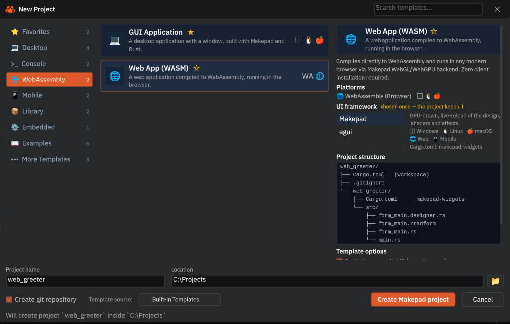
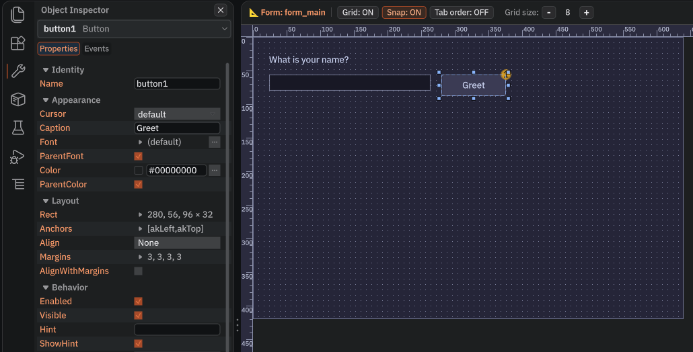
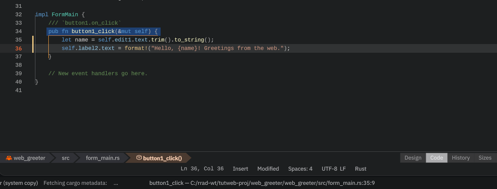
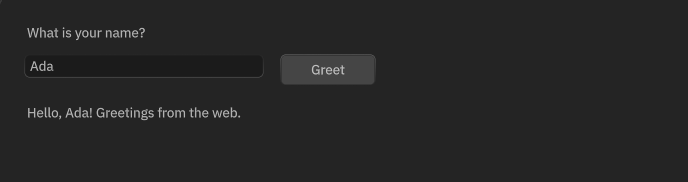
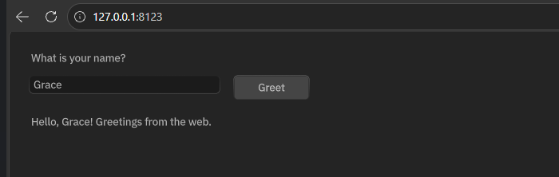
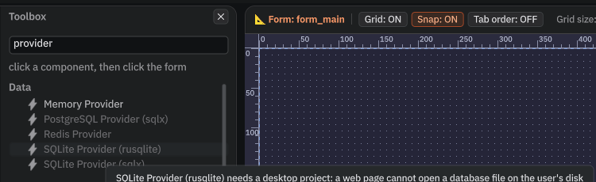

# Publishing your app for the web

> **About 15 minutes** · Windows, Linux, macOS · No Rust experience needed

**You will build** a small greeter that runs in the browser: type your name,
click a button, and the page greets you. Then you will take the files CrawRAD
made and serve them yourself, the way you would put them on a website. Along
the way you will:

- create a project from the **Web App (WASM)** template;
- add a form to it and design it;
- run it in your browser;
- find the folder that holds the finished page and serve it.

This tutorial assumes you have done [Your first app](your-first-app.md): placing
components and writing a handler work the same way here.

## Before you start

A web project builds to WebAssembly, so Rust needs that target once:

```sh
rustup target add wasm32-unknown-unknown
```

## 1. Create the project

Choose **File › New Project…**. In the dialog, pick **WebAssembly › Web App
(WASM)**, name it `web_greeter`, choose a folder under **Location**, and click
**Create Makepad project**.



The template marks the project as a web project in its `Cargo.toml`:

```toml
[package.metadata.crawrad]
platform = "web"
```

That line is what makes **Run** open the browser instead of a window.

> **Checkpoint.** The project opens on its form, `form_main`, in the Designer,
> as a desktop project does. The template already wrote `form_main.crawform`,
> its generated code and the `main.rs` that starts the app from it.

## 2. Design the form

Place four components, as in the first tutorial:

| Component | Name | Set |
|---|---|---|
| **Label** | `label1` | **Caption** `What is your name?` |
| **Edit** | `edit1` | clear its text |
| **Button** | `button1` | **Caption** `Greet` |
| **Label** | `label2` | clear its text, and make it wide: it will hold the greeting |

Select the form itself and set its **Caption** to `Web Greeter`. Then select
`label1` and set **FocusControl** to `edit1`: the form checker suggests it,
since that label names the Edit.



The components and their properties are the same as on the desktop. The
target only changes the code CrawRAD generates for them.

## 3. Write the handler

Double-click **Greet**. In `form_main.rs`, inside the new handler, type:

```rust,ignore
let name = self.edit1.text.trim().to_string();
self.label2.text = format!("Hello, {name}! Greetings from the web.");
```



Save with <kbd>Ctrl</kbd>+<kbd>S</kbd>.

## 4. Run it in the browser

Press <kbd>F5</kbd> (<kbd>F9</kbd> in the Classic keymap). The status bar shows
the build, then `building web_greeter for the browser…`. The first time takes a
few minutes: everything is compiled again for WebAssembly, in release mode.

When it is done, the status bar reads
`built — web_greeter running in the browser at http://127.0.0.1:…/` and your
default browser opens that address. Type a name and click **Greet**.



> **Checkpoint.** The page reads **Hello, Ada! Greetings from the web.**

CrawRAD serves the page itself, on your machine only. **Stop** takes the page
down.

## 5. Find the files to publish

Every Run writes the whole page into one folder of the workspace:

```text
web_greeter/target/crawrad-web/web_greeter/
├── index.html
├── web_greeter.wasm
├── makepad_platform/        (the page's JavaScript loader)
├── makepad_wasm_bridge/
└── makepad_…/resources/     (fonts and other resources)
```

That folder is the whole app. Nothing else is needed on the server: copy the
folder as it is to any host that serves static files. It is large (about 54 MB,
mostly fonts), so the first load over a slow link takes a while.

> **Note.** **Build** alone does not write this folder. Run once after your last
> change, then copy it.

## 6. Serve it yourself

To check the folder the way a web server would show it, serve it with any
static file server. With Python, from the workspace folder:

```sh
cd target/crawrad-web/web_greeter
python -m http.server 8123
```

Open `http://127.0.0.1:8123/` in your browser.



The server must send `.wasm` files as `application/wasm`. Python's server does,
and so do the common web servers. Do not open `index.html` straight from the
disk: browsers refuse to load WebAssembly from a `file://` page.

## What about databases?

A web page cannot open a SQLite file on the user's disk, nor a network socket to
a database server. In a web project the Toolbox keeps those components listed
but greyed: both **SQLite** providers, the **PostgreSQL** and **Redis**
providers, and the **OpenDialog** and **SaveDialog**. Rest the pointer on one
to read why. They cannot be placed on the form. Keep the database forms of the
previous tutorials for desktop projects.



## What you learned

- A project is a web project because of `platform = "web"` in its `Cargo.toml`.
  See [Targets: native, web and mobile](../concepts/targets.md).
- The form, the components and your handlers are the same as on the desktop.
- **Run** builds WebAssembly, writes the page to `target/crawrad-web/<name>`, serves
  it and opens your browser. That folder is what you publish.

The finished project is in `examples/web-greeter` in the CrawRAD repository.
