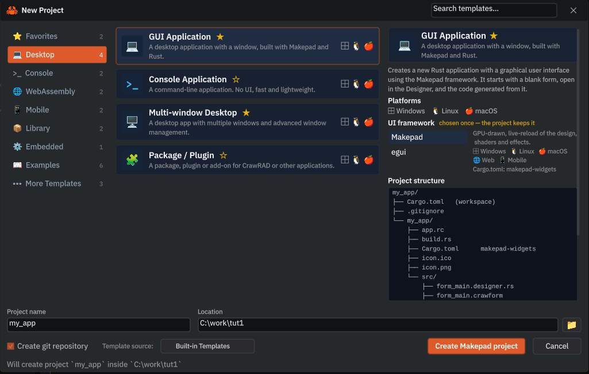
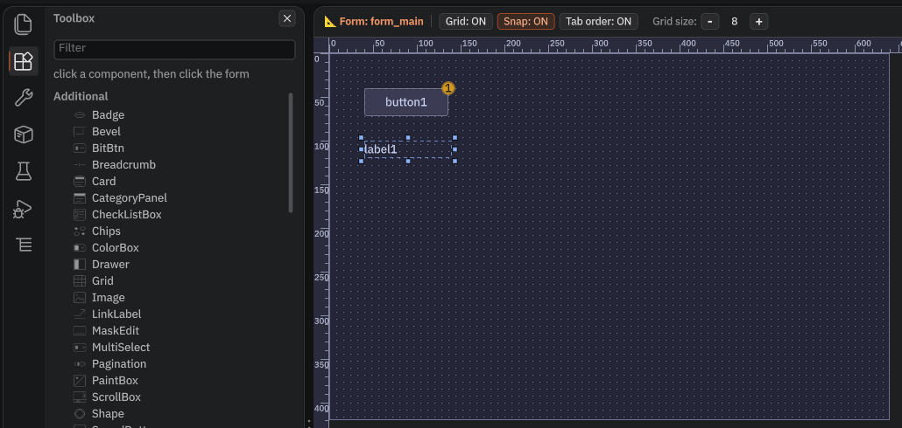
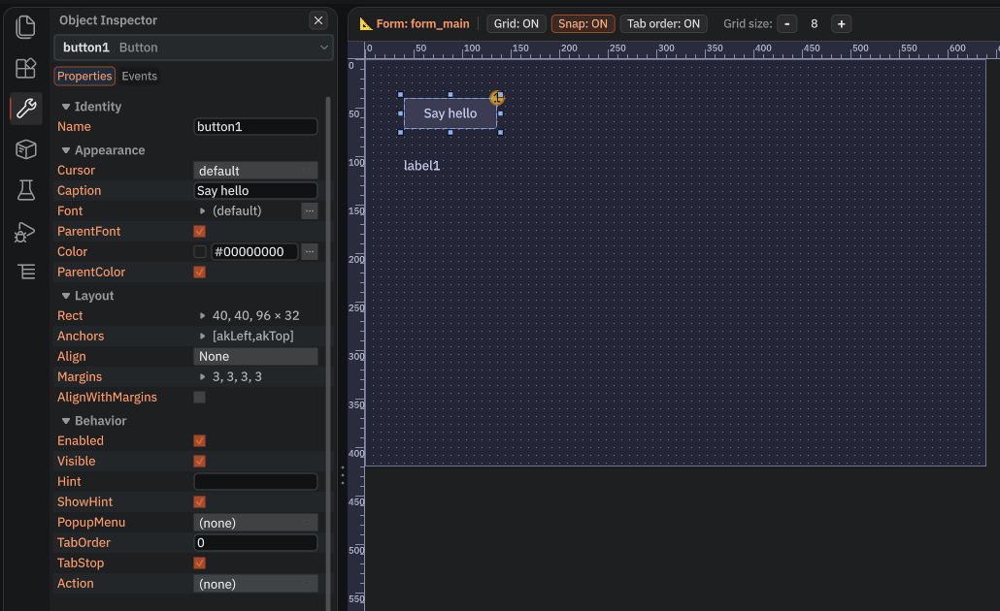
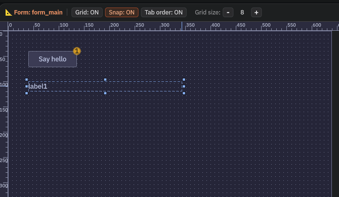
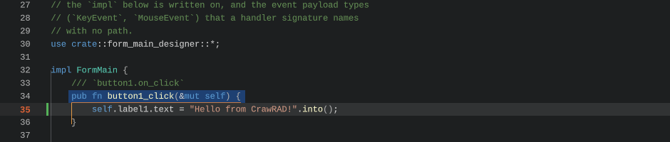
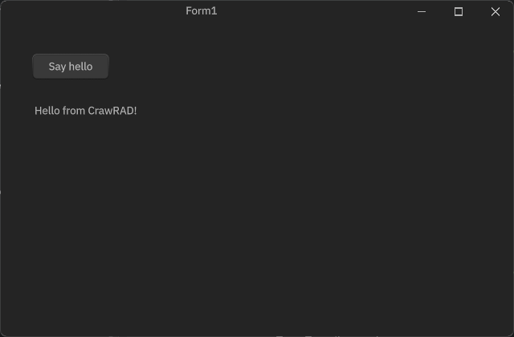

# Your first app

> **About 10 minutes** · Windows, Linux, macOS · No Rust experience needed

**You will build** a window with a button and a label. When you click the button, the
label says hello. Along the way you will:

- create a project from a template;
- place components on a form;
- set a property in the Object Inspector;
- write your first event handler and run the app.

## 1. Create the project

Choose **File › New Project…**. In the dialog, pick **Desktop › GUI Application**, keep
the name `my_app`, choose a folder under **Location**, and click **Create Makepad
project**.



The right side of the dialog shows what will be created: a Cargo workspace named
`my_app`, with the project inside it.

> **Checkpoint.** The Designer opens with an empty form called `form_main`.

## 2. Place a button and a label

Open the **Toolbox** on the left rail. Click **Button**, then click on the form where it
should go. Do the same with **Label**, a little below the button.



The small orange badge on the button comes from the **form checker**, which points out
details worth a look. You can leave it for now.

## 3. Set the button's caption

Click the button to select it. Open the **Object Inspector** on the left rail: the box
at its top names what is selected, **button1 · Button**. Set **Caption** to `Say hello`
and press <kbd>Enter</kbd>.



> **Tip.** The box at the top of the Object Inspector is also a list. Open it to pick any
> component of the form, the form itself included.

## 4. Make room for the text

The label will show a longer text than `label1`. Click the label, then drag the handle
on its right edge until the label is about three times wider.



A label keeps the size you give it, so text longer than the label is cut off at run
time. Making it wide now avoids that.

## 5. Write the handler

Double-click the button. CrawRAD switches to **Code** view, opens `form_main.rs` and
creates the click handler, with the cursor already inside it, at the right
indentation. Type:

```rust,ignore
self.label1.text = "Hello from CrawRAD!".into();
```

The whole handler now reads:

```rust,ignore
/// `button1.on_click`
pub fn button1_click(&mut self) {
    self.label1.text = "Hello from CrawRAD!".into();
}
```



Save with <kbd>Ctrl</kbd>+<kbd>S</kbd>.

> **Checkpoint.** `form_main.rs` is yours: CrawRAD never regenerates it. The
> `` /// `button1.on_click` `` line is how CrawRAD knows which event this function answers.

## 6. Run it

Press <kbd>F5</kbd> (<kbd>F9</kbd> in the Classic keymap). The first build takes a
while; the next ones are quick. When the window opens, click **Say hello**.



> **Checkpoint.** The label reads **Hello from CrawRAD!**

## What you learned

- A form has two files: the designer file, which CrawRAD writes, and `form_main.rs`,
  which is yours. See [Forms: the designer file and your file](../concepts/forms-and-files.md).
- Double-clicking a component goes from **Design** view to **Code** view, straight to its
  handler. See [Design view and Code view](../concepts/design-and-code.md).

**Next:** [A form that reads a database](a-form-that-reads-a-database.md).
