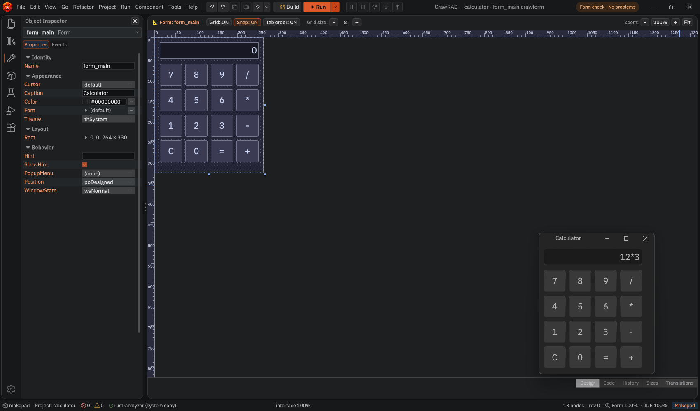
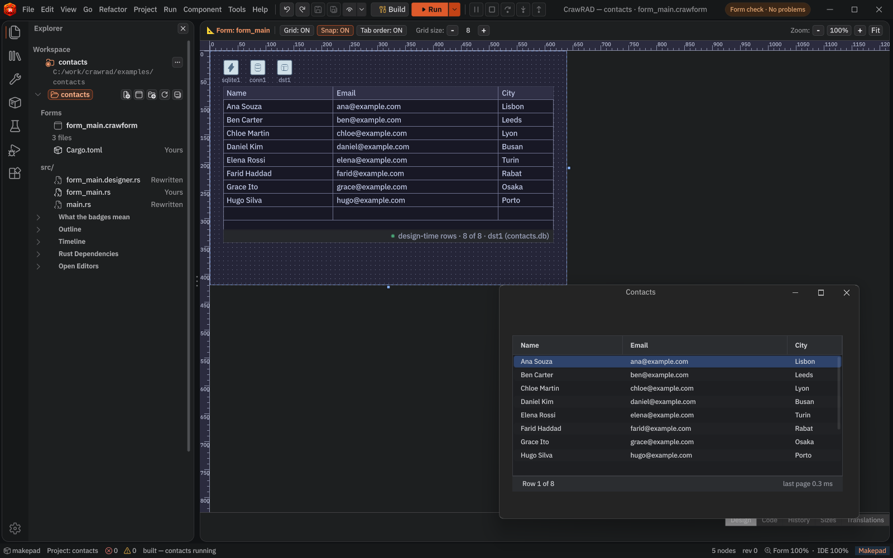

# Examples

Real projects made in CrawRAD — the forms were laid out in the Designer and the
handlers written in `form_main.rs`. Open a folder's `Cargo.toml` with **File › Open
Project…**, or build it from the command line:

```sh
cargo run --manifest-path examples/calculator/Cargo.toml
```

| Example | What it shows |
|---|---|
| [calculator](calculator/) | 16 buttons wired to click handlers; the display holds the expression, evaluated with `*` and `/` before `+` and `-`. |
| [contacts](contacts/) | A Grid bound to a `Dataset` (an SQL query) on a `Connection` and a `SqliteProvider`, listing the contacts of the shipped `contacts.db` in name order. No code: the form is the whole app. The tutorial [A form that reads a database](../docs/src/tutorials/a-form-that-reads-a-database.md) builds it step by step. |
| [contacts-edit](contacts-edit/) | The same contacts table opened in table mode: click a row and three Edits bound to its fields show it; Insert, Save, Delete and Cancel buttons run dataset actions that write to `contacts.db`. No code. The tutorial [A form that edits a database](../docs/src/tutorials/a-form-that-edits-a-database.md) builds it step by step. |
| [web-greeter](web-greeter/) | A Web App (WASM) project with one form: type a name, click Greet, and a label greets you. **Run** builds it to WebAssembly and opens it in the browser. The tutorial [Publishing your app for the web](../docs/src/tutorials/publishing-your-app-for-the-web.md) builds it step by step and shows how to serve the page. |
| [extensions/formatter](extensions/formatter/) | A reference extension: one `manifest.json` adds a menu entry, a shortcut, an MCP tool and a project template — no code inside the IDE. |





Every example is checked by `gate.ps1` (clippy, warnings as errors).
